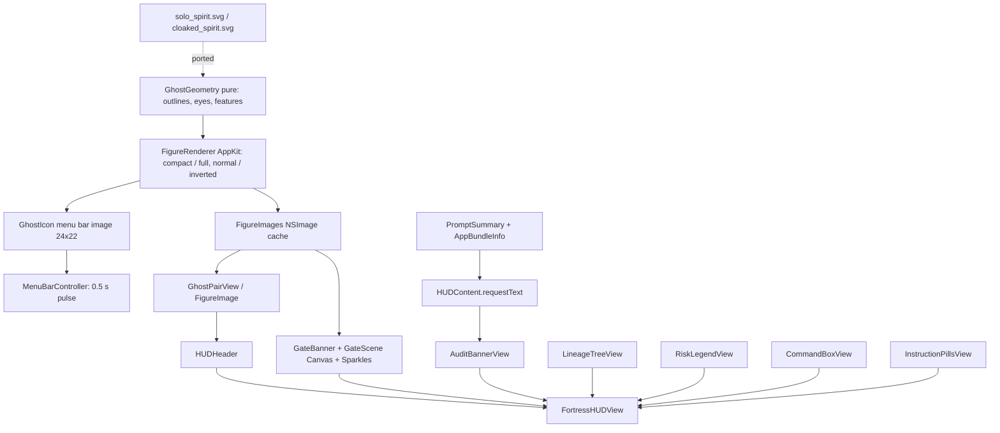

# Design Document

## Overview

This feature restyles the Fortress HUD and the menu bar icon to match the Castle Keep mock (`docs/Planning/Styles/The Castle Keep & The Wandering Spirits.jpg`), and makes the HUD explain a permission request in plain words. It extends `.kiro/specs/ward-app` and `.kiro/specs/hud-placement-and-menubar-theme`.

All art is vector code, with no raster assets. The two characters are ported from reference SVGs chosen by the team: `docs/Planning/Styles/solo_spirit.svg` (the smaller `solo` spirit with a swooping tail) and `docs/Planning/Styles/cloaked_spirit.svg` (the larger `cloaked` spirit). They are described once as framework-free geometry (`GhostGeometry`) and drawn by one AppKit renderer (`FigureRenderer`) at two detail levels: compact for the menu bar and full for the HUD and review images. The scene art around them (`GateBanner`) is a SwiftUI `Canvas`.

Design decisions:

- **One renderer for both places.** The menu bar needs an `NSImage`, and the HUD shows the same drawing through an `NSImage` drawing handler, which stays resolution independent. This keeps the characters identical everywhere and avoids a second SwiftUI copy of the art.
- **SVG fidelity.** The path commands keep the SVG's own coordinates, so the code can be compared with the SVG files line by line. The cloaked spirit differs from its SVG in three stated ways: the lower body is 22% wider, it sweeps right with a curled hem, and the three vertical drape lines are left out.
- **Compact is not a small copy of full.** At about 20 pt tall, fine detail is noise. Compact detail uses a strong outline, large eyes and a bold smile, and drops gloss, rim light, blush, glints and the aura.
- **Opaque menu bar icon.** The icon must look the same on light and dark bars, so it never uses the translucent tail of the full-detail art. Its alert pulse flips between a normal and an inverted palette instead.
- **Inform only.** The two pills in the HUD are labels. Nothing in the HUD is a control, because the Ward cannot press Apple's buttons.
- **Say what Apple says.** The HUD shows the sentence from Apple's dialog and the app's own stated reason, read from the app's `Info.plist`. Reading another app's window titles would need Screen Recording permission, so that route is not used.
- **Data honesty.** Nothing is invented for looks: the legend shows only the risk categories found, the command box shows the real command, and the sentence uses the real service and app.

## Architecture



## File layout

```
GatekeepersWard/
├── Core/
│   └── AppBundleInfo.swift         (new: display name and usage descriptions from an app's Info.plist)
├── HUD/
│   ├── CastlePalette.swift         (changed: ectoplasmShade role)
│   ├── HUDContent.swift            (changed: ectoplasmShade, requestText, displayedRequest, visibleMasterApp)
│   ├── PromptSummary.swift         (new: RequestText, Apple-style sentences, Info.plist keys per service)
│   ├── FortressHUDView.swift       (changed: composition, HUDMetrics, SectionLabel)
│   ├── HUDHeader.swift             (new)
│   ├── AuditBannerView.swift       (new)
│   ├── LineageTreeView.swift       (new: LineageLayout, ProcessLineageView)
│   ├── RiskLegendView.swift        (new: RiskLegend, RiskLegendView)
│   ├── CommandBoxView.swift        (new: CommandBoxView, RiskTagView)
│   ├── InstructionPillsView.swift  (new: InstructionCopy, InstructionPillsView)
│   ├── FortressHUDWindow.swift     (changed: drops its view tree on dismiss, presentation counter)
│   └── Art/
│       ├── GhostGeometry.swift     (new: pure geometry)
│       ├── FigureRenderer.swift    (new: the one AppKit renderer)
│       ├── CastleNSColors.swift    (new: fixed sRGB palette for AppKit)
│       ├── FigureImage.swift       (new: FigureImages cache, FigureImage, GhostPairView)
│       ├── NeonTextStyle.swift     (new: NeonText)
│       ├── GateScene.swift         (new: wall, gate, torches, sparkles on a Canvas)
│       ├── GateBanner.swift        (new: the scene plus three bobbing spirits)
│       └── Sparkles.swift          (new: stars and wisps, deterministic)
└── MenuBar/
    ├── GhostIcon.swift             (changed: draws the pair with FigureRenderer, lantern, poses)
    └── MenuBarController.swift     (changed: variable length, 0.5 s pulse)
```

## Components and interfaces

### `GhostGeometry` (pure)

Imports `Foundation` and `CoreGraphics` only. A figure is described in a unit square (origin bottom-left, y up). SVG commands are written with the SVG's coordinates (y down) and mapped into the unit square by a window that is computed from the outline's own bounding box, so every figure is centred with a 6% margin for the outline, even after the cloak is changed.

```swift
enum FigureKind { case solo, cloaked }
enum FaceExpression { case happy, sleepy, surprised }

enum GhostGeometry {
    static let cloakWidening: CGFloat   // 0.22: lower body wider than the SVG
    static let cloakSweep: CGFloat      // 14 SVG units: hem sweeps right, eased in from the neck
    static let cloakCurl: CGFloat       // 8 SVG units: right end of the hem lifts

    static func bodyOutline(_ kind: FigureKind) -> [PathSegment]
    static func eyes(_ kind: FigureKind, _ expression: FaceExpression) -> [EyeSpec]
    static func highlights(_ kind: FigureKind) -> [EyeSpec]     // main gloss, then a small sparkle
    static func features(_ kind: FigureKind, _ expression: FaceExpression) -> [FeatureSpec]
}
```

The cloak transform applies three steps to each SVG point, by its own height: widen about the centre line (full strength from the waist down), shift right by `cloakSweep * t^1.6` (zero at the neck), and lift the right end of the hem by `cloakCurl`. The head and face are not moved. The solo spirit is unchanged.

### `FigureRenderer` (AppKit)

`draw(_ kind, _ expression, in: frame, detail:, style:)` draws into the current graphics context.

- **Outline.** Two tones, as in the SVGs: Midnight Violet outside and Spirit Ink inside. At full detail a Kiro Violet aura sits behind it. Strokes are centred on the edge and the fill covers the inner half, so the visible width is half the stroke width.
- **Fill and shading.**
  - *Compact:* the base gradient only (Spectral Ectoplasm to Ectoplasm Shade with a violet tint at the hem).
  - *Full:* a darker lavender base, so edges can be brighter than the middle; a soft white radial light near the top of the head; a violet radial bounce at the hem; an inner rim light (a white stroke with a white shadow, clipped to the body so only the inside glow shows).
- **Highlights and face.** Full detail: a main flat gloss ellipse, a small round sparkle, eye glints and blush. Eyes and the smile are Spirit Ink. Compact: no gloss, glints or blush; the eyes are scaled 1.5x (sleepy eyes 2.4x vertically so they stay visible), the smile is 1.4x longer, and the outline is 1.4 pt.
- **Inverted style** (compact, for the alert pulse): a dark body gradient (Midnight Violet to Spirit Ink), a light outline (Spectral Ectoplasm with a Kiro Violet inner line) and light eyes and smile.
- **Translucent tail (full only).** The figure is drawn inside a Core Graphics transparency layer, then a vertical `destinationOut` gradient erases the lower body progressively toward the hem, so body, rim, outline and aura dissolve together. The layer isolates the erase from whatever is behind the figure. The gradient is vertical on purpose: an angled one leaves a visible seam along the top of the erased region.

### Menu bar icon

`GhostIcon.image(_ pose)` keeps its signature. The image is 24 by 22 pt, drawn from two frames that leave about 1.5 pt around each figure for the outline. The cloaked spirit is drawn first and the solo spirit in front of it. Poses:

- `idle`: sleepy eyes on both, no lantern.
- `alert`: wide eyes, normal palette, lantern raised above the solo spirit.
- `alertBlink`: wide eyes, inverted palette, lantern lowered.

The lantern is drawn on top (handle ring, cap, amber frame, light flame). `MenuBarController` uses `NSStatusItem.variableLength` and alternates `alert` and `alertBlink` every `pulseInterval` (0.5 s) until the prompt resolves. The accessibility label and tooltip are unchanged.

### Art in SwiftUI

- `FigureImages` (`@MainActor`) builds and caches vector `NSImage`s with a drawing handler that calls `FigureRenderer` at full detail. A single figure is drawn inside a 14% inset so its aura is not cropped; the pair image draws the solo spirit in front of the cloaked one, as in the icon.
- `FigureImage` and `GhostPairView` wrap them and are hidden from VoiceOver.
- `NeonText` draws the title with a violet outline (eight offset copies) and two violet shadows. The mock's display face cannot be bundled, so it is a heavy rounded system font; a gothic face would be a one-line change.
- `GateScene` paints, on a `Canvas`: a brick wall in two slate tones with edge darkening, an arched opening with a violet glow, a portcullis (bars with spear tips, two rails, scrolls along the base), two torches (bracket, cup, two-layer flame, radial amber glow) and twinkling sparkles from `Sparkles.bannerSparks`. `time` drives the flicker and twinkle; 0 gives a still image.
- `GateBanner` is 400 by 88 pt: the scene plus three spirits that bob out of step. It runs in a `TimelineView` that is paused when Reduce Motion is on. The window drops its view tree when the HUD is dismissed, which stops the animation.
- `Sparkles` holds deterministic star and wisp layouts. Wisps are used in the review images only: on the banner floor they looked like stray arcs.

### HUD sections

`FortressHUDView` is a 400 pt wide composition, top to bottom:

1. `GateBanner`.
2. `HUDHeader`: `NeonText`, the vault name capsule (the raw key as its tooltip), and `GhostPairView`.
3. `AuditBannerView`: the heading "SECURITY AUDIT: TCC EVENT DETECTED"; the plain-language sentence; the app's stated reason when there is one; the status line ("Spirit Paused at the Gate"); and the raw service key, small and dim. Amber, or crimson when the status is suspicious.
4. `ProcessLineageView`: an indented tree with a connector arrow per row, a terminal-style tile holding the process's spirit icon, the name and PID, and an amber glow on the process that asked. The responsible app is shown beside the "Lineage" heading when it is not already the first process of the chain (`HUDContent.visibleMasterApp`).
5. `RiskLegendView`: crimson chips for the risk categories found (`RiskLegend.rows`), nothing when none.
6. `CommandBoxView`: the command in a monospaced box (up to 12 lines, growing to fit), a `vault:` line, the working directory and the flagged arguments. Amber border, crimson when suspicious. The full command is a tooltip and can be selected.
7. `InstructionPillsView`: "Answer in Apple's dialog" and two glowing pills, "Don't Allow / Lower Portcullis" and "Allow / Let Spirit Pass". Hit testing is off and VoiceOver reads one combined sentence (`InstructionCopy.accessibilityLabel`). The string "Allow" is Apple's own button name and is marked `palette-ok` for the copy check.

Pure helpers hold the logic so it can be unit tested: `LineageLayout.rows` (a chain longer than five rows keeps the first process, a "… N more" row and the last three; indentation follows screen position and is capped at four), `RiskLegend.rows`, `InstructionCopy`, `HUDContent.visibleMasterApp`.

**Size.** The card is 400 pt wide. Its height follows its content: under 720 pt for typical content, and `HUDMetrics.maxHeight` (900 pt) is only a hard stop. A test measures the unclamped height, because the clamped value would always pass. `FortressHUDWindow` already reads `fittingSize`, so placement beside Apple's alert keeps working.

### Plain-language request text

- `PromptSummary.headline(service:appName:)` gives one question per service in Apple's wording, such as `Allow “WardTrigger” to access your microphone?`. With no app name it says "an app"; unknown services get a generic sentence.
- `AppBundleInfo` finds the outermost `.app` that contains an executable, reads `Contents/Info.plist` and keeps `CFBundleDisplayName` (else `CFBundleName`) and every `NS…UsageDescription`. Only that file is read, so no new permission is needed. `PromptSummary.usageDescriptionKeys` lists the keys per service, newest first.
- `HUDContent.build` names the responsible app when it differs from the process that asked, otherwise the process itself, and stores a `RequestText` (sentence and optional reason). `bundleInfo` is an injectable closure for tests. Hand-built content falls back to `displayedRequest`, which uses the generic sentence.

### Palette changes

`CastleTone.ectoplasmShade` is `#C7D2FE`. Three colours from the chosen SVGs join the palette: Spirit Ink `#2E1065`, Midnight Violet `#3B185F` and Blush Pink `#F472B6`. `CastleNSColors` holds fixed sRGB copies for AppKit drawing. The steering files, the palette hook and the copy check are updated; a line containing `palette-ok` is exempt from the check.

## Testing strategy

- `GhostGeometryTests`: closed outlines with the SVG curve counts; every point inside the unit square; centred with a margin; the cloak is wider at the hem than at the head and sweeps right with a lifted hem; the solo spirit keeps its SVG shape; eyes inside the figure; expressions differ; two highlights; determinism.
- `FigureRendererTests`: the full-detail tail is far more transparent than the head; compact stays opaque to the hem; the aura exists only at full detail; the hem is darker than the upper body; sparkle layouts are deterministic.
- `GhostIconTests`: the image is 24 by 22; non-template; normal frames have a light body and a Midnight Violet outline; the inverted frame has a dark body and a light outline; the two alert frames swap body colours; both figures present; eyes contrast with the body and are at least 2.5 pt wide; amber only in alert poses; identical pixels under `.aqua` and `.darkAqua`. The bitmap context draws at full pixel size (an earlier version drew at one pixel per point and did not check the right half).
- `HUDSectionTests`: unclamped height for no-process, typical and worst-case content; a longer command makes the card taller; lineage rows (short, long, capped depth, empty); master app de-duplication; legend order and emptiness; pill copy, wording and VoiceOver sentence.
- `PromptSummaryTests`: the microphone sentence; a natural question for every service; folders named; "an app" without a name; plist keys per service; outermost-bundle lookup; display name precedence and newest-key preference; a real `Info.plist` in a temporary `.app`; the sentence names the responsible app and shows its reason; fallbacks.
- `ArtDraftRenderer` (runs only with `WARD_RENDER_DRAFTS=1`) writes review images to `docs/Planning/Styles/drafts/`.
- Existing property tests (parsers, placement) and the window tests pass unchanged.
- Manual, with `WardTrigger` on a real Mac: HUD beside Apple's alert, Apple's dialog keeps focus, light and dark menu bars, Reduce Motion, two prompts at once.

## Risks

- Hand-built vector characters will not match a painted illustration. Mitigation: SVG-based shapes, layered shading and the rim light carry most of the depth.
- The translucent tail and aura are costly to draw. Mitigation: images are cached, the banner redraws only its `Canvas` and the three bobbing images, and the timeline pauses under Reduce Motion and is torn down on dismiss.
- Apple may change its dialog wording between macOS versions. Mitigation: the sentences live in one pure function with a test per service, so a wording change is one edit.
- The app's `Info.plist` may not contain a reason, or the process may not be inside an app (for example `rg`). Mitigation: the reason line is optional, and the sentence falls back to the responsible app or the process name.
- Compact art is judged by eye at 1x and 2x. Mitigation: the draft renderer shows both on light and dark bars, and the pixel tests guard contrast and eye size.
