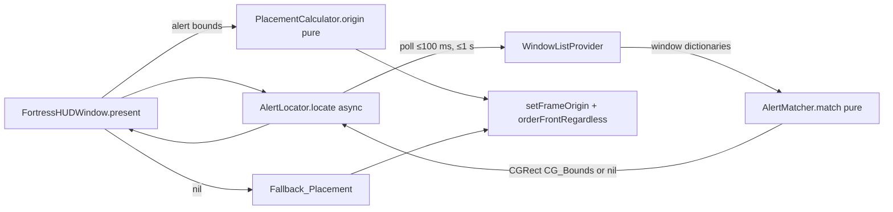

# Design Document

## Overview

This feature makes two changes to Gatekeeper's Ward, extending `.kiro/specs/ward-app`.

1. The menu bar ghost becomes a full-colour, non-template image in the Castle Keep palette. It renders the same pixels on light and dark menu bars.
2. The Fortress HUD is placed 10 px to the right of Apple's TCC alert, top-aligned with it. The Ward finds the alert through `CGWindowListCopyWindowInfo`, which exposes owner name, layer and bounds without the Accessibility permission. If the alert is not found within 1 second, the HUD uses the existing top-right placement.

The placement geometry lives in a pure type, `PlacementCalculator`, so it can be tested without a screen. Window-list parsing is also split into a pure function, so the match logic can be property tested without the window server.

Design decisions:

- We still only inform. The HUD never takes key focus and never touches the alert.
- Only the window server's public list is used. No Accessibility, no screen recording. `kCGWindowName` is not read, because it needs Screen Recording permission on recent macOS. Matching uses owner name, layer and bounds only.
- Polling runs in a `Task` with `Task.sleep`, never blocking the main thread.
- The owner name and layer of the TCC alert are not guessed. They are recorded from an empirical check on a real Mac (Requirement 2.3, 5.4) and held in one constants struct.

## Architecture



Presentation flow in `present(_:)`:

1. Build the hosting view and compute `fittingSize` (as today).
2. Order the panel front at the fallback position immediately, so the HUD is never delayed by the search.
3. Start a `Task` that awaits `AlertLocator.locate()`. On the main actor, when it returns bounds, compute the origin with `PlacementCalculator` and move the panel. When it returns nil, leave it at the fallback position.

Placing the fallback first and moving once is a design choice: the user sees the HUD at once and the HUD then jumps beside the alert if found. Because the alert usually already exists when the TCC log line arrives, the first poll normally succeeds before the fade-in finishes. To avoid a visible jump, the panel starts at alpha 0 and the fade-in begins after the first locate result (or after timeout). Under Reduce Motion the panel is shown at alpha 1 after the locate result.

## Components and Interfaces

### `GhostIcon` (modified, `MenuBar/GhostIcon.swift`)

Drawing is changed from black template fill to palette colours. The `Pose` enum and `image(_:)` signature are unchanged.

```swift
enum GhostIcon {
    enum Pose { case idle, alert, alertBlink }

    /// Renders the full-colour ghost. Never a template image.
    static func image(_ pose: Pose) -> NSImage {
        let image = NSImage(size: NSSize(width: 18, height: 18), flipped: false) { _ in
            drawBody(fill: .spectralGradient, outline: .kiroViolet)
            drawEyes(pose)                 // destinationOut cut-outs
            if pose != .idle { drawLantern(raised: pose == .alert, colour: .torchlightAmber) }
            return true
        }
        image.isTemplate = false
        return image
    }
}
```

Drawing details:

- Body: filled with a vertical two-stop `NSGradient` from `#E0E7FF` (top) to `#C7D2FE` (bottom). Outline stroked at 1 pt in `#8B5CF6`.
- Eyes: cut out with `.destinationOut`, as today. This satisfies "transparent cut-outs" in 1.4. (Obsidian Slate is the permitted alternative and is not used.)
- Lantern: filled with `#F59E0B` only for `.alert` and `.alertBlink`. The idle pose draws no lantern.
- Colours are fixed `NSColor(srgbRed:green:blue:alpha:)` values, not dynamic or semantic colours, and drawing does not read `NSAppearance.current`. This is what makes the pixels appearance independent.
- The drawing handler is evaluated lazily by AppKit at the current appearance, so it must use only fixed colours. Any `NSColor` named/system colour is forbidden in this file.

The colours are taken from the existing `CastlePalette` where it exposes `NSColor` values; otherwise small private constants in `GhostIcon` are used. This is checked during implementation against `HUD/CastlePalette.swift`.

### `MenuBarController` (modified)

Wherever it assigns `statusItem.button?.image`, the image comes from `GhostIcon.image(_:)` and is not mutated afterwards. Any `contentTintColor` set on the button is removed, since a tint would alter a non-template image on some systems. No other behaviour (animation timing, pose sequencing) changes.

### `PlacementCalculator` (new, `HUD/PlacementCalculator.swift`)

Pure value type. Imports `Foundation` only (uses `CGRect`, `CGPoint`, `CGSize`, which are value types with no window-server dependency).

```swift
/// Computes the Fortress HUD origin beside the TCC alert.
struct PlacementCalculator {
    /// Horizontal gap between the alert and the HUD, in points.
    static let gap: CGFloat = 10

    /// - Parameters:
    ///   - alertCG: alert bounds in CG global coordinates (origin top-left of primary screen, y down).
    ///   - hudSize: the HUD panel size.
    ///   - primaryScreenHeight: height of the primary screen, used for the y flip.
    ///   - visibleFrame: target screen visible frame in AppKit coordinates (origin bottom-left, y up).
    /// - Returns: the AppKit origin (bottom-left) for the HUD panel.
    static func origin(alertCG: CGRect, hudSize: CGSize,
                       primaryScreenHeight: CGFloat, visibleFrame: CGRect) -> CGPoint
}
```

Algorithm:

1. Flip: `alertTop = primaryScreenHeight - alertCG.minY` (AppKit top edge). Alert left and right edges are `alertCG.minX` and `alertCG.maxX`.
2. Preferred x = `alertCG.maxX + gap`. Preferred top = `alertTop`.
3. Horizontal: if `x + hudSize.width > visibleFrame.maxX`, set `x = alertCG.minX - gap - hudSize.width` (left of the alert). Then clamp: `x = min(x, visibleFrame.maxX - width)`, then `x = max(x, visibleFrame.minX)`. Applying the lower bound last means an oversized HUD aligns to the visible frame left edge (3.8).
4. Vertical: `top = min(top, visibleFrame.maxY)`, then `top = max(top, visibleFrame.minY + height)`, then `top = min(top, visibleFrame.maxY)`. The final min means an oversized HUD aligns its top to the visible frame top (3.8). `y = top - height`.
5. Return `CGPoint(x: x, y: y)`.

The clamps are written with `min`/`max` and no branches beyond the one left-flip test, so the function is total and deterministic.

### `AlertMatcher` (new, `HUD/AlertLocator.swift`)

Pure function that picks the alert from window-list entries.

```swift
/// One entry from the window server list, reduced to the fields the Ward reads.
struct WindowInfo: Equatable {
    var ownerName: String?
    var layer: Int?
    var bounds: CGRect?
}

enum AlertMatcher {
    /// Returns the CG bounds of the TCC alert, or nil when none matches.
    static func match(_ windows: [WindowInfo],
                      ownerName: String, layer: Int) -> CGRect?
}
```

Rules: a window matches when `ownerName` and `layer` equal the configured values and `bounds` is non-nil with positive width and height. Entries missing bounds are skipped (2.7). If several match, the first in window-list order is returned (the list is front to back, so this is the frontmost).

A second small function, `WindowInfo.init(dictionary:)`, converts a `CFDictionary` entry (`kCGWindowOwnerName`, `kCGWindowLayer`, `kCGWindowBounds`) to `WindowInfo` using `CGRect(dictionaryRepresentation:)`. It uses optional casts only.

### `AlertLocator` (new, same file or `HUD/AlertLocator.swift`)

```swift
/// Locates Apple's TCC alert through the window server list.
///
/// Empirically verified on <macOS version>: owner name "<recorded>", layer <recorded>.
/// (Values are filled in from the on-device check; see docs/devlog.md.)
struct AlertLocator {
    static let ownerName = "<recorded>"
    static let layer = 0   // replaced by the recorded value

    static let timeout: TimeInterval = 1.0
    static let pollInterval: TimeInterval = 0.1   // ≤ 100 ms

    /// Source of window list entries, injectable for tests.
    var windowList: @Sendable () -> [WindowInfo]

    /// Polls until the alert is found or the timeout elapses.
    func locate() async -> CGRect?
}
```

`locate()` loop: capture the start time from `ContinuousClock`; query `windowList()`; if `AlertMatcher.match` returns bounds, return them; if elapsed ≥ `timeout`, return nil; otherwise `try? await Task.sleep` for `pollInterval` and repeat. If the task is cancelled, it returns nil. The default `windowList` calls `CGWindowListCopyWindowInfo([.optionOnScreenOnly, .excludeDesktopElements], kCGNullWindowID)`. Since the call is made from a non-main async context and each call is short, the main thread stays free (2.8). The `windowList` closure being injected lets tests supply scripted lists and a zero-delay clock.

The owner name and layer are placeholders in this document by design. The implementation task for the empirical check runs `WardTrigger`, dumps the window list while the TCC dialog is up, records the values, writes them into the constants and the doc comment, and adds them to `docs/devlog.md` (5.4).

### `FortressHUDWindow` (modified)

- Style mask, `.floating` level, `canBecomeKey == false` and `canBecomeMain == false` are unchanged (4.1, 4.2).
- `present(_:)` recomputes `fittingSize` on every call, and the placement uses that size each time (4.4).
- New private `place(size:alertCG:)` method: gets the target screen as the screen whose frame contains the alert centre (converted to AppKit), else `NSScreen.main`; reads `NSScreen.screens.first?.frame.height` as the primary screen height; calls `PlacementCalculator.origin`; then `setFrameOrigin`.
- New private `fallbackOrigin(size:)` keeps the current top-right logic with the 16 px margin.
- The panel is ordered front with `orderFrontRegardless()` and never `makeKeyAndOrderFront` (4.3).
- A locate `Task` is stored and cancelled when a new `present` call arrives or on `dismiss()`, so a stale result never moves a newer panel.
- The file is near the 300 line limit when growing; the placement helpers go in an extension in `HUD/FortressHUDWindow+Placement.swift` if needed.

## Data Models

| Type | Fields | Notes |
|---|---|---|
| `WindowInfo` | `ownerName: String?`, `layer: Int?`, `bounds: CGRect?` | Reduced window list entry |
| `PlacementCalculator` | static `gap = 10` | Stateless |
| `AlertLocator` | `timeout = 1.0`, `pollInterval = 0.1`, `windowList` closure, recorded `ownerName`/`layer` | Constants from the empirical check |

Coordinate systems:

- `CG_Bounds`: origin top-left of the primary screen, y down. Input from the window server.
- `AppKit_Frame`: origin bottom-left of the primary screen, y up. Output for `setFrameOrigin`.
- Conversion: `appKitTop = primaryScreenHeight - cgMinY`.

## Error Handling

| Condition | Behaviour |
|---|---|
| Window list returns nil or empty | `windowList()` yields `[]`; no match; fallback placement (2.7) |
| Entry has no bounds or non-positive size | Skipped by `AlertMatcher` (2.7) |
| Alert not found within 1 s | `locate()` returns nil; fallback placement (2.6) |
| Task cancelled (new present, dismiss) | `locate()` returns nil; result ignored |
| Alert on a screen other than main | Target screen chosen by alert centre; visible frame of that screen used for clamping |
| HUD larger than visible frame | Aligned to visible frame top/left (3.8) |
| No screens available | No placement is attempted, the panel keeps its previous origin |

No error is surfaced to the user. All failures degrade to the existing placement.

## Correctness Properties

*A property is a characteristic or behavior that should hold true across all valid executions of a system-essentially, a formal statement about what the system should do. Properties serve as the bridge between human-readable specifications and machine-verifiable correctness guarantees.*

### Property 1: Coordinate conversion and adjacency

For any alert CG_Bounds, any HUD size and any primary screen height, when the visible frame is large enough that no clamping or flipping occurs (the HUD fits to the right of the alert and vertically inside the visible frame), the returned frame has its top equal to `primaryScreenHeight - alert.minY` and its left edge equal to `alert.maxX + 10`.

**Validates: Requirements 3.1, 3.2, 3.3, 3.4**

### Property 2: Left flip when the right side overflows

For any alert, HUD size and visible frame where `alert.maxX + 10 + hud.width` exceeds `visibleFrame.maxX` and the left-of-alert placement fits inside the visible frame horizontally, the returned frame's right edge equals `alert.minX - 10`.

**Validates: Requirements 3.5**

### Property 3: Result is contained in the visible frame

For any alert, any primary screen height, any visible frame and any HUD size that is no larger than the visible frame in both dimensions, the returned frame lies entirely inside the visible frame.

**Validates: Requirements 3.6, 3.7, 4.4**

### Property 4: Oversized HUD aligns to top-left

For any alert, visible frame and HUD size larger than the visible frame in a dimension, the returned frame is aligned to the visible frame left edge (when wider) and to the visible frame top edge (when taller).

**Validates: Requirements 3.8**

### Property 5: Alert matching selects only valid matching windows

For any list of window entries, `AlertMatcher.match` returns bounds only if some entry has the configured owner name, the configured layer and non-empty bounds, and then returns the bounds of the first such entry. It returns nil when no entry qualifies, including when the list is empty or all entries lack bounds.

**Validates: Requirements 2.2, 2.3, 2.7**

## Testing Strategy

Both unit tests and property tests are used. Swift Testing is the existing framework. Swift has no built-in property testing library, so properties use a seeded generator loop of at least 100 iterations (matching the approach used by the existing `ParseProcArgsBufferTests` and NDJSON parser tests). Each property test carries the tag `Feature: hud-placement-and-menubar-theme, Property N: <text>`.

### Property tests

- `PlacementCalculatorPropertyTests`: Properties 1 to 4, with generators for alert rects, HUD sizes and visible frames. Generators constrain inputs to each property's precondition (for example, Property 1 builds a visible frame that surrounds the alert with room to spare).
- `AlertMatcherPropertyTests`: Property 5, with random lists mixing matching and non-matching owner names and layers, missing bounds and zero-size bounds.

### Unit tests (examples and edge cases)

- `PlacementCalculator`: right-side case, left-side case, vertical clamp top, vertical clamp bottom, horizontal clamp, oversized HUD, and the coordinate conversion on a known screen (3.10).
- `AlertLocator.locate()`: injected `windowList` returning the alert on the third poll returns bounds; never returning it returns nil after the timeout; empty list returns nil; a poll interval of at most 100 ms is asserted via the constant (2.4, 2.6).
- `GhostIcon`: for each pose, `isTemplate == false` (1.1); render to a bitmap and check that the body, outline colours are present (1.2, 1.3), the eye area is transparent (1.4), amber pixels exist for `.alert` and `.alertBlink` and not for `.idle` (1.5, 1.6); render under `NSAppearance(named: .aqua)` and `.darkAqua` using `performAsCurrentDrawingAppearance` and compare the pixel buffers for equality (1.7). These are example tests because the pose set is finite.
- `FortressHUDWindow`: style mask contains `.nonactivatingPanel` and `.borderless`, level is `.floating`, `canBecomeKey` and `canBecomeMain` are false (4.1, 4.2). Presenting twice with different content sizes yields frames using each size (4.4).
- Integration and manual: verify with `WardTrigger` on a real Mac that the HUD sits beside the real alert, that Apple's dialog keeps focus (4.3), and that the main thread stays responsive while polling (2.8). Requirements 1.8 and 5.x are verified by compile, the existing suite and review.

### Pre-requisite check

Before the locator constants are finalised, run the empirical window list dump with `WardTrigger` (see Components, AlertLocator), and record the result in `docs/devlog.md`.
