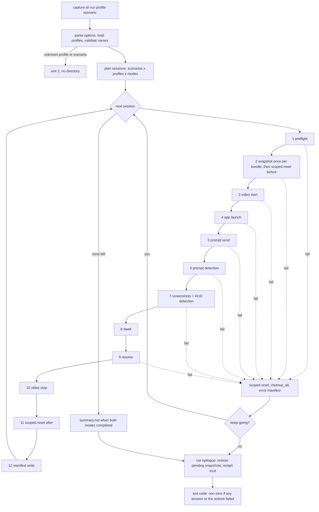

# Design Document

## Overview

The Permission Capture Framework is a set of shell scripts under `scripts/capture/` that records macOS TCC permission prompts raised by AI coding agent apps, once without Gatekeeper's Ward (`baseline`) and once with it (`ward`). It produces screenshots, a video, and a JSON manifest for each Capture_Session. It adds no runtime code to the Ward app.

The framework has one entry script, `capture.sh`, with the subcommands `setup`, `teardown`, `reset`, `restore`, `prompt`, `run`, `list`, `doctor`, and `export`. Everything it needs comes from macOS: `osascript`, `screencapture`, `tccutil`, `sqlite3`, `mdls`, `pgrep`, and an optional `ffmpeg`. A small Swift script is used only to ask macOS whether a permission is granted without prompting.

`tccutil reset` deletes the developer's real grants for the target app. To avoid that loss, the framework saves the affected rows of the user-level TCC database before the first reset of a run and writes them back when the run ends, fails, or is interrupted. All database access lives in one file, `lib/tccdb.sh` (the TCC_Access_Module). It opens only the user-level database, touches only the target app's rows for the profile's declared services, and takes a full backup copy before any write. The rest of the framework contains no reference to a TCC database file.

### Design decisions

| # | Decision | Rationale |
|---|---|---|
| D1 | Implement the CLI in **bash**. Scripts start with `#!/usr/bin/env bash` and use only features present in both bash 3.2 (the macOS system bash) and bash 5.x: no associative arrays, no `mapfile`. | Requirement 14.8 allows `zsh` or `bash`. The other scripts in `scripts/` are bash. Avoiding bash 4 features keeps the scripts working on a stock Mac. |
| D2 | Every value passes to `osascript`, `tccutil`, `screencapture`, and `pgrep` as a separate **argv element**. AppleScript and JXA sources are fixed files that read `argv`. No value is ever spliced into script source or into a string given to `eval`. | Requirement 13.10. Passing argv removes the need to escape for AppleScript at all. The only quoting code is the `%q` renderer used for dry-run output and logs. |
| D3 | Profiles are **parsed, never sourced**. The format is `key = value` lines read by a restricted parser. | A sourced profile could run arbitrary code. A parser also lets the validator name the exact missing field (4.6). |
| D4 | All side effects go through one function, `ext`, which prints the quoted command in dry-run mode and runs it otherwise. | Requirement 14.5 needs the full text of every external command and no execution. One choke point makes that testable. |
| D5 | Pure decision logic (profile validation, bundle-ID guard, reset plan, session paths, crop rectangle, window matching, session planning, manifest checks) lives in `lib/*.sh` functions with no I/O. | These functions are the ones property-based tests can drive. |
| D6 | JSON is produced and parsed with **`osascript -l JavaScript`** (`lib/json.js`), not `jq` or Python. | Requirement 14.8 forbids extra dependencies. `osascript` is already required. |
| D7 | Window discovery uses `CGWindowListCopyWindowInfo` through JXA (`lib/windows.js`). It never reads `kCGWindowName`. | Verified on this Mac: JXA reads owner, number, layer, and alpha with no Screen Recording grant. Matches `AlertLocator` in the app. |
| D8 | Permission status checks for Accessibility, Screen Recording, and Automation use `scripts/capture/lib/permcheck.swift`, run with `swift`. Full Disk Access is checked by `tcc_probe` in `lib/tccdb.sh`. | Only `AEDeterminePermissionToAutomateTarget(askUserIfNeeded: false)` checks Automation without prompting, and JXA cannot build the `AEDesc` it needs. Accessibility (`AXIsProcessTrusted`) and Screen Recording (`CGPreflightScreenCaptureAccess`) use the same helper for consistency. macOS has no preflight API for Full Disk Access, and the only reliable test is a read-only open of the database, which Requirement 13.11 confines to `tccdb.sh`. |
| D9 | Automated tests are **pytest + Hypothesis**, reusing the virtualenv at `.kiro/tools/.venv` (Hypothesis 6.170.15 is already pinned in `.kiro/tools/requirements.txt`). Tests call the bash functions through subprocesses, with stub binaries for `tccutil`, `osascript`, `screencapture`, and `pgrep` placed first on `PATH`. | Requirement 14.3 needs tests that pass with no macOS permissions. The project's own steering requires a real PBT library rather than hand-rolled generators. Swift Testing is not used because the code under test is bash. |
| D10 | One run timestamp is chosen per `capture.sh run` invocation and shared by every Capture_Session of that run. | Requirement 9.10 needs `baseline` and `ward` to be siblings. `--all-scenarios` and `--all-profiles` then land under one timestamp directory. |
| D11 | All TCC database access is in **one file**, `lib/tccdb.sh`, which uses the system `sqlite3` CLI. A static scan enforces that no other file under `scripts/capture/` (except tests and `*.md`) contains `TCC.db` or `com.apple.TCC`. | Requirements 13.1, 13.11, 17. One small file is auditable, and the scan makes a stray reference a test failure. |
| D12 | Snapshots are **schema-agnostic and typed**. The column list comes from `PRAGMA table_info(access)`, and every cell is stored as a tagged string: `i:<int>`, `t:<hex>`, `b:<hex>`, or `n:`. Text and blobs are hex of their bytes. A real number makes the snapshot fail closed. | The `access` schema changes between macOS releases. Hex needs no quoting, so `csreq` blobs and any text round-trip byte for byte (15.2, 13.12). |
| D13 | Restore deletes the scope rows and re-inserts the snapshot rows with `INSERT OR REPLACE` in **one transaction** (`BEGIN IMMEDIATE` ... `COMMIT`, with `.bail on`). It then re-reads and compares. | Requirements 16.4 to 16.8. Delete-then-insert ends in the same state as "replace present rows, delete extra rows", and a failure rolls everything back. |
| D13a | Profiles and snapshot JSON (`services`, `services_without_row`) use tccutil short names; `tcc_db_service` maps each to `kTCCService<Name>` (unless already prefixed) only where a value enters SQL or is compared with an `access.service` cell. | The real `access.service` column stores the prefixed name, so a verbatim short name matches no row. |
| D14 | The restore runs **once per run**, after the last session's end-of-session reset, and in every failure and signal path. `reset` takes the snapshot and leaves it pending. | One snapshot per bundle per run (15.4) means one restore. `reset` exists to leave the app reset, so restoring inside it would undo the command. The developer runs `restore` or `teardown` afterwards. |

### Findings from inspecting the repo and this Mac

These resolve the assumptions that were open when the requirements were written.

1. **TCC prompt window owner.** `GatekeepersWard/HUD/AlertLocator.swift` and `docs/devlog.md` record the owner `UserNotificationCenter`, window layer `8`, and a size of about 260 x 282 pt. That was measured on macOS 27.0.1 (build 26A434). This Mac runs **macOS 27.2.1 (build 26B131)** and has not been re-measured. The framework therefore uses the same two values as defaults, makes them overridable (`CAPTURE_PROMPT_OWNER`, `CAPTURE_PROMPT_LAYER`), and `doctor` prints the macOS version next to them so a mismatch is visible. `scripts/dump_window_list.swift` is the documented way to re-measure.
2. **Ward HUD window.** `FortressHUDWindow` is an `NSPanel` with `styleMask [.nonactivatingPanel, .borderless, .fullSizeContentView]`, `level = .floating`, and a fixed width of `HUDMetrics.width = 400` pt. Its title is not set. The window server reports the owner as the executable name, `GatekeepersWardApp` (from `CFBundleExecutable` in `GatekeepersWardApp/Info.plist`), not "Gatekeeper's Ward". `NSWindow.Level.floating` is layer `3`. The panel starts at alpha `0` and fades in after the placement lookup, so the matcher requires alpha above 0.9 and a width within 2 pt of 400. That excludes the menu bar status item, which is also owned by `GatekeepersWardApp`.
3. **Ward menu bar item.** The status item is an on-screen window owned by `GatekeepersWardApp` at status-bar level. The existing window dump shows the menu bar `Window Server` at layer 24, so the item is expected at layer 25 (`kCGStatusWindowLevel`). This has not been observed because Ward is not running now. The matcher accepts any on-screen `GatekeepersWardApp` window with layer 24 or higher, and the first implementation task records the measured value.
4. **Target apps.** `/Applications/ZCode.app` has bundle ID `dev.zcode.app`. `/Applications/DeepSeek Harness.app` has bundle ID `com.deepseek.dsh`. Both profiles use these.
5. **Ward launch.** `scripts/run_ward.sh` builds with `swift build`, wraps the binary in `.build/GatekeepersWard.app`, signs ad hoc, and runs `open -n`. It returns after launching and does not print a PID. It also runs `pkill` on any running copy, so the framework calls it only when no Ward process exists. The framework finds the PID afterwards with `pgrep -n -f GatekeepersWard.app/Contents/MacOS/GatekeepersWardApp`, the same pattern `run_ward.sh --stop` uses. The 10 second menu bar timeout (9.5) starts when `run_ward.sh` returns, so build time is not counted.
6. **Tool availability.** `ffmpeg` is at `/opt/homebrew/bin/ffmpeg`. `screencapture` supports `-v` (video), `-l<windowid>`, `-R<x,y,w,h>`, `-D<display>`, `-o` (no shadow), and `-x` (no sound). `osascript -l JavaScript` can call `CGWindowListCopyWindowInfo` with `ObjC.castRefToObject` and returns owner, number, layer, and alpha.
7. **Existing conventions.** `scripts/reset_ward_trigger.sh` already resets TCC with `tccutil reset <service> <bundle>`. `scripts/hooks/*.sh` are bash. `captures/` is not yet in `.gitignore`, and the only Python tests are in `.kiro/tools/tests/`.
8. **Guarded by project hooks.** `scripts/hooks/guard-security-boundaries.py` and the `macos-security-boundaries` steering file currently forbid TCC database access. Requirements 13.1 and 15 to 17 add one exception: `scripts/capture/lib/tccdb.sh`, on the user-level database only. The implementation tasks must (a) add a narrowly worded exception to the steering file and (b) change the hook to allow exactly that path, so that any other file referencing a TCC database is still blocked. The hook's current matching rules must be read before editing it.
9. **Full Disk Access has no preflight API.** The user database cannot be opened without it, so a read-only open is the only probe. Granting it needs the Capture_Host to be restarted in some macOS versions, which the README notes.
10. **Write protection is unverified.** Recent macOS releases can refuse writes to the user database even with Full Disk Access, and `tccd` caches grants in memory. Restore therefore reports failure cleanly (16.13) and restarts `tccd` after a verified write (16.9). Whether a write succeeds on 27.2.1 is settled by the first implementation task (see Open items).

## Architecture

### File layout

```
scripts/capture/
├── capture.sh                  # entry point: parses options, dispatches subcommands
├── README.md
├── lib/
│   ├── common.sh               # ext(), log_step(), die(), quoting, exit codes, UTC time
│   ├── profile.sh              # load, parse, validate App_Profiles (pure parts + file I/O)
│   ├── validate.sh             # pure option validators (resolve, display, timeouts, dwell)
│   ├── reset.sh                # bundle-ID guard, reset plan, reset execution
│   ├── tccdb.sh                # TCC_Access_Module: the ONLY file that names a TCC database
│   ├── restore.sh              # restore subcommand, run-level snapshot/restore wiring, tccd restart report
│   ├── plan.sh                 # session planning and failure policy (pure)
│   ├── session.sh              # Session_Directory naming, creation, step runner, summary.md
│   ├── manifest.sh             # accumulate manifest fields, write/validate manifest.json
│   ├── windows.sh              # window matching (pure) + window list polling
│   ├── shots.sh                # screenshots, crop rectangle (pure), display lookup
│   ├── video.sh                # recorder start/stop, playable check
│   ├── ward.sh                 # start/stop Ward, Marker_File, menu bar detection
│   ├── app.sh                  # launch target app, focus input, send prompt, approve step
│   ├── resolve.sh              # button lookup and click, dismissal check
│   ├── cleanup.sh              # teardown actions, signal traps
│   ├── setup.sh                # setup, doctor, Setup_State_File merge
│   ├── focus.sh                # --redact-notifications state save/restore
│   ├── export.sh               # export subcommand
│   ├── services.tbl            # TCC service key -> prompt keywords, button labels
│   ├── json.js                 # JXA: build and re-serialize JSON
│   ├── windows.js              # JXA: window list and display list as TSV
│   ├── ui.applescript          # System Events: focus, type, click, read prompt text
│   ├── clipboard.js            # JXA: snapshot/restore all pasteboard types
│   ├── focus.applescript       # Control Center Focus toggle (see Open items)
│   └── permcheck.swift         # permission status/request without side effects (4 permissions; FDA is in tccdb.sh)
├── profiles/
│   ├── zcode.profile
│   ├── deepseek-harness.profile
│   └── _template.profile.example
└── tests/
    ├── conftest.py             # bash harness, stub-bin builder, Hypothesis strategies
    ├── test_profile.py  test_reset_guard.py  test_quoting.py  test_paths_manifest.py
    ├── test_windows_crop.py  test_plan.py  test_validate.py  test_dryrun.py
    ├── test_setup_state.py  test_export_summary.py  test_cleanup.py
    ├── test_tccdb.py  test_tcc_restore.py  test_tcc_wiring.py  test_tcc_scan.py
    └── stubs/                  # tccutil (edits the temp DB), osascript, screencapture, pgrep, open,
                                # pkill, sqlite3 (logs argv, then runs /usr/bin/sqlite3)
```

`captures/` is added to `.gitignore`. Runtime state lives in `captures/.state/` (`setup.json`, `ward.pid`, `recorder.pid`, `launched.txt`, `focus-state`, `clipboard.snap`, `tcc-snapshot-<bundle_id>.json`, `tcc-snapshot-<bundle_id>.restored.json`, `TCC.db.backup-<timestamp>`).

### Run flow



### TCC snapshot and restore placement

The twelve numbered steps are unchanged. Snapshot and restore are not new steps. They are printed as extra lines (`tcc-snapshot`, `tcc-restore`) in the step log, so Requirement 12.1's order still holds.

- **Snapshot** runs inside step 2 (`reset`), before the first `tccutil reset` for a bundle ID in the run. `tcc_ensure_snapshot` does nothing when this run already took the snapshot for that bundle, or when a pending snapshot exists from an earlier crashed run (reusing it keeps the developer's original grants, since the database now holds reset state). A failure fails step 2, and no `tccutil` command runs (15.7).
- **Restore** runs once, in the run epilogue, after the last session's `reset-after` step (16.1). With `--keep-going` and several sessions it still runs once.
- **Failure path.** The runner now runs the session's scoped reset first, then `cleanup_all`, whose last TCC action is the restore. The earlier text ordered cleanup before the reset. The reset must come first, because a restore followed by a reset would delete the restored grants again.
- **Signal path.** The `INT`/`TERM` trap runs the session reset when a session is active, then `cleanup_all` (which restores), then exits 130 or 143.
- **`prompt`** is a one-session run and follows the same flow. **`reset`** takes the snapshot, resets, and leaves the snapshot pending (D14).
- **`--no-restore`** removes every snapshot, backup, probe, and restore action. A notice is printed (15.10).

The twelve step names, in order, are `preflight`, `reset`, `video-start`, `app-launch`, `prompt-send`, `prompt-detection`, `screenshots`, `dwell`, `resolve`, `video-stop`, `reset-after`, `manifest-write`. These are the names printed (12.9), recorded as the failing step in the manifest (11.5), and listed by `--dry-run`.

### Ordering inside `screenshots`

Requirement 7.1 needs `screen.png` and `prompt.png` within 2 seconds of prompt detection, but the HUD can take up to 10 seconds to appear. The `screenshots` step therefore does the following in order:

1. Capture `screen.png` and `prompt.png` at once.
2. In `ward` mode, poll for the HUD every 250 ms for up to 10 seconds, record it in the manifest, then capture `hud.png` and `pair.png` within 2 seconds of the HUD appearing.

With `--no-images`, step 1 and the capture calls in step 2 are skipped, but HUD polling still happens so the manifest and the `no_hud` outcome stay accurate (6.4 to 6.6).

### Cleanup model

One idempotent function, `cleanup_all`, performs every teardown action. It is called by the `teardown` subcommand, by the step runner on a failed step, and by the `INT`/`TERM` trap. It reads only `captures/.state/`, so it also works from a fresh shell after a crash. The `EXIT` trap calls it only when a session started and has not finished normally. Actions, in order:

1. Restore the clipboard from `clipboard.snap` if present.
2. Send `SIGINT` to the PID in `recorder.pid`, wait up to 10 s, check playability (2.5).
3. Send `SIGTERM` to the PID in `ward.pid`, wait up to 5 s, send `SIGKILL` if needed, delete the Marker_File (2.1 to 2.3).
4. Quit each bundle ID in `launched.txt` that the framework launched, wait up to 10 s each, never force-kill (2.6, 2.7).
5. Run `restore_all` (2.11, 16.1, 16.3, 16.15): for every pending `captures/.state/tcc-snapshot-<bundle_id>.json`, call `tcc_restore`, then `tcc_verify`, then restart `tccd` and rename the snapshot to `.restored.json` on success. A failure here is recorded and does not stop the remaining actions.
6. Restore the Focus state from `focus-state` if present.
7. Print the revoke guidance for each permission `setup.json` records as originally missing (2.4).

Restore comes after the app has quit (4), so the target app is not writing to the database while rows are replaced, and after the session's scoped reset (run by the caller before `cleanup_all`). When `restore_all` failed, `cleanup_all` returns non-zero after finishing actions 6 and 7, and `teardown` exits 1.

The signal trap then exits with 130 (`SIGINT`) or 143 (`SIGTERM`), whatever the restore result, and prints the restore failure first.

## Components and Interfaces

### Exit codes

| Code | Meaning |
|---|---|
| 0 | Success |
| 1 | A step failed, a check failed, or a tool is missing |
| 2 | Usage error or validation error detected before any step ran |
| 130, 143 | Interrupted by `SIGINT`, `SIGTERM` |

### `capture.sh` subcommands and options

| Subcommand | Options | Notes |
|---|---|---|
| `setup` | `--no-restore` | 5 status lines, requests missing permissions, opens Settings panes, writes Setup_State_File. With `--no-restore` the Full Disk Access line reads `full-disk-access: skipped (--no-restore)` and is not probed |
| `doctor` | `--no-restore`, `--video-backend` | Read-only. Never calls a request function and never writes state. Also prints whether a pending TCC_Snapshot exists |
| `teardown` | none | Runs `cleanup_all`, including the Restore. Exit 0 and a message when nothing exists |
| `reset <profile>` | `--service <svc>`, `--dry-run`, `--no-restore` | Snapshot (once), then scoped `tccutil reset`. The snapshot stays pending |
| `restore [<profile>]` | `--dry-run` | Restores one profile's pending snapshot, or every pending snapshot. Exit 0 with a message when none is pending |
| `prompt <profile> <scenario>` | `--mode`, `--resolve`, `--no-reset`, `--no-video`, `--no-images`, `--no-restore`, `--video-backend`, `--display`, `--dry-run`, `--redact-notifications` | One Capture_Session |
| `run <profile> <scenario>` | all `prompt` options plus `--all-scenarios`, `--all-profiles`, `--keep-going` | Baseline then ward, each with a fresh reset. Restore once at the end |
| `list` | none | One line per profile |
| `export <dir>` | none | Copies `*.png` and `flow.*` |

`prompt` and `run` share one session runner. `prompt` with no `--mode` runs `baseline`. `run` with no `--mode` runs `baseline` and then `ward`.

### `lib/common.sh`

| Function | Contract |
|---|---|
| `ext cmd args...` | In dry-run: print `+ ` followed by the `%q`-quoted command and return 0. Otherwise run the command with each argument as one argv element |
| `quote_cmd args...` | Pure. Prints `printf '%q '` of each argument. Evaluating the output in bash yields the original argv |
| `log_step name` | Prints `<UTC ISO-8601 seconds> step: <name>` to stdout and appends the same line to `$SESSION_DIR/capture.log` (skipped in dry-run, where no file may be written) |
| `die code msg` | Writes `msg` to stderr, exits with `code` |
| `utc_now_ms` | UTC ISO-8601 with milliseconds |

macOS `date` has no `%N`, so `utc_now_ms` calls `osascript -l JavaScript -e 'new Date().toISOString()'`. That always yields millisecond precision in UTC and needs no extra dependency.

### `lib/profile.sh`

Profile file format (3 forms of line, `#` starts a comment, blank lines ignored):

```
# scalar fields
profile_id     = zcode
display_name   = ZCode
bundle_id      = dev.zcode.app
launch         = open -b dev.zcode.app
input_locator  = ax:text area 1 of scroll area 1 of group 1 of window 1
send_action    = key:return
send_method    = clipboard            # optional: clipboard (default) | keystroke
launch_timeout = 20                   # optional, 1..300, default 20
approve_tool_call = ax:button "Allow"  # optional

# scenarios: scenario.<name>.<field>
scenario.desktop.prompt         = List the files on my Desktop. Only read names, change nothing.
scenario.desktop.service        = SystemPolicyDesktopFolder
scenario.desktop.prompt_timeout = 45  # optional, 1..300, default 45
scenario.desktop.dwell          = 4   # optional, 1..60, default 4
```

| Function | Pure? | Contract |
|---|---|---|
| `profile_parse path` | no | Reads the file, prints `key<TAB>value` lines. Rejects a line that is not blank, a comment, or `key = value`. Never executes content |
| `profile_validate path` | yes (given parsed text) | Checks required fields (`profile_id`, `display_name`, `bundle_id`, `launch`, `input_locator`, `send_action`), 1 to 20 scenarios, prompt length 1 to 2,000 characters, non-empty service, numeric ranges, and that `profile_id` equals the file name without `.profile`. Prints `path: missing field <name>` or `path: profile_id '<x>' does not match file name '<y>'` |
| `profile_load_all dir` | no | Loads every `*.profile` in `dir`, skips everything else (including `_template.profile.example`). A profile with errors makes the whole command exit 2 before any step |
| `profile_services id` | yes | Distinct scenario service keys in declaration order. This is the list `reset` walks (3.1) |
| `profile_scenarios id` | yes | Scenario names in declaration order |

The `list` command prints `profile_id<TAB>bundle_id<TAB>scenario,scenario,...`. With no loadable profile it prints `no profiles found` and exits 1 (4.4).

The template's `launch` and `input_locator` forms:

- `launch`: any command whose words are split once and run through `ext`, for example `open -b <bundle>`. The first word must be `open`, `osascript`, or an absolute path under `/Applications`.
- `input_locator`: `ax:<System Events element path>`. The path is passed to `ui.applescript` as one argv value and resolved against the app's front window. Using argv means the locator text cannot inject script source.
- `send_action`: `key:return`, `key:cmd+return`, or `ax:<element path to click>`.

### `lib/validate.sh` (pure)

| Function | Accepts |
|---|---|
| `valid_resolve v` | exactly `allow`, `deny`, `none` |
| `valid_display idx count` | decimal integer with `1 <= idx <= count` |
| `valid_range v lo hi` | decimal integer in `[lo, hi]`, no sign, no leading `+`, no spaces |
| `with_default v dflt` | `v` when non-empty, else `dflt` |

Defaults: launch timeout 20 s (1 to 300), prompt timeout 45 s (1 to 300), HUD timeout 10 s (fixed), dwell 4 s (1 to 60).

### `lib/reset.sh`

| Function | Pure? | Contract |
|---|---|---|
| `guard_bundle_id id known_ids...` | yes | Returns 0 only when `id` is non-empty, is not `All` in any letter case, and is exactly one of the loaded profiles' bundle IDs. Otherwise prints `refusing tccutil reset for bundle id '<id>'` to stderr and returns 1 |
| `reset_plan profile [--service s]` | yes | Prints one line per `tccutil reset <service> <bundle>` command. All services in order, or only `s`. Returns 2 with a message naming `s` and the valid services when `s` is not listed |
| `reset_run profile [--service s] [--dry-run]` | no | Calls `guard_bundle_id` for every planned command before running any. Runs each command through `ext`, prints `<command> -> exit <n>`, continues after a failure, exits non-zero at the end if any failed. In dry-run prints the plan and exits 0 |

Session-start reset (3.8, 3.9) and session-end reset (10.7, 10.8) call `reset_run` with `--service <scenario service>`. A failure at session start stops the session before `prompt-send`. A failure at session end sets a warning, a manifest field, and a non-zero exit but does not skip the remaining cleanup.

`reset_run` is called after `tcc_ensure_snapshot` for the same profile (see "Run wiring" below). Its own guard checks are unchanged.

### `lib/tccdb.sh` (TCC_Access_Module)

The only file that names a TCC database. It sources `reset.sh` for `guard_bundle_id`. It calls `sqlite3` from `PATH`, which lets tests put a logging wrapper first. Every SQL script goes to `sqlite3` on **stdin**, never in argv, and begins with `.bail on`.

**Path guard (17.1, 17.2)**

| Function | Pure? | Contract |
|---|---|---|
| `tcc_path_ok candidate home tmpdir test_env` | yes | Resolves symbolic links in `candidate` (and in the other two paths). Returns 0 when it equals `<home>/Library/Application Support/com.apple.TCC/TCC.db`. Returns 0 for any other path only when `test_env` is non-empty and the resolved path lies strictly inside the resolved `tmpdir`. The system-level database path is never accepted. Otherwise prints `refusing database path '<p>'` and returns 1 |
| `tcc_db_path` | no | Computes the path: `$CAPTURE_TCC_DB_TEST` when set, else the user database path. Calls `tcc_path_ok` with `$HOME`, `$(getconf DARWIN_USER_TEMP_DIR)`, and the variable. Exits non-zero on refusal |

The system temporary directory is the user's `DARWIN_USER_TEMP_DIR` (also accepting `/tmp` and `/private/tmp`). A test path that is a symlink out of that directory resolves outside it and is refused.

**Probe (1.9, 12.7)**

`tcc_probe` returns 0 when `sqlite3` exists and `sqlite3 -readonly <db> 'SELECT 1 FROM access LIMIT 1'` succeeds. It writes nothing. A missing `sqlite3`, a missing file, or any open error returns 1 and prints the cause (`sqlite3 not found`, or the sqlite error text). `perm_status full-disk-access` calls it, and prints `granted` or `missing` accordingly. `setup` opens `x-apple.systempreferences:com.apple.preference.security?Privacy_AllFiles` for it. No request API exists, so `perm_request full-disk-access` only opens the pane.

**Literal builders (13.12, pure)**

| Function | Contract |
|---|---|
| `sql_quote s` | Prints `'` + `s` with each `'` doubled + `'`. Fails for a string with NUL |
| `tcc_valid_bundle s` | `^[A-Za-z0-9][A-Za-z0-9._-]*$`, not `All` in any case, not empty |
| `tcc_valid_service s` | `^[A-Za-z][A-Za-z0-9]*$` |
| `tcc_ident s` | Accepts a column name matching `^[A-Za-z_][A-Za-z0-9_]*$` and prints it double-quoted. Anything else is refused |
| `cell_literal cell` | `i:<n>` (`^-?[0-9]{1,19}$`) prints `<n>`. `t:<hex>` prints `CAST(X'<hex>' AS TEXT)`. `b:<hex>` prints `X'<hex>'`. `n:` prints `NULL`. `<hex>` must match `^([0-9A-Fa-f]{2})*$`. Any other cell (including `r:`) is refused |

Bundle IDs and service keys are validated first and then quoted with `sql_quote`, so a validation gap is not an injection path. Values from a snapshot file never pass through `sql_quote`. They pass through `cell_literal`, which only emits digits, hex, or `NULL`.

**Guards (17.4, 17.5)**

`tcc_guard bundle service... -- known_bundle...` calls `guard_bundle_id` and then checks that every service is non-empty, passes `tcc_valid_service`, and is declared by the selected profile. On refusal it prints the rejected value and returns 1 before any `sqlite3` call.

**Snapshot, backup, restore, verify**

| Function | Contract |
|---|---|
| `tcc_scope_query bundle services...` | Pure. Prints the SQL that selects every column of the Snapshot_Scope rows as tagged cells (below), ordered by `service, rowid`, with `WHERE client = <q(bundle)> AND service IN (<q(s)>, ...)`. The column list is an argument |
| `tcc_columns` | Runs `PRAGMA table_info(access)` read-only and prints column names after `tcc_ident` validation. Fails when `service` or `client` is absent |
| `tcc_rows bundle services...` | Opens the database with `-readonly`, runs `tcc_scope_query`, prints one row per line as tab-separated cells. Fails closed when any cell is `r:` (a real number) |
| `tcc_snapshot bundle services...` | Guards, then writes `captures/.state/tcc-snapshot-<bundle>.json` atomically (temp file in the same directory, then rename). Re-reads the file and compares its row count with the query's (15.8). On any failure removes the temp file and returns non-zero, and prints the reason, plus the Full Disk Access pane when the open failed |
| `tcc_backup run_ts` | If `captures/.state/TCC.db.backup-<run_ts>` exists, returns 0 and does nothing (never overwrites, 15.9). Otherwise `cp -p` of the database, then checks that the copy has the same byte size as the source and that `sqlite3 -readonly <copy> 'SELECT count(*) FROM access'` succeeds (17.7). On failure deletes the copy and returns 1. Earlier backup files are never touched. When `-wal` and `-shm` files exist beside the database they are copied with it |
| `tcc_restore bundle` | Reads the snapshot, applies the guards (bundle must be in a loaded profile, snapshot services must all be declared by that profile), builds the script (below), runs it, then calls `tcc_verify`. Does not rename the snapshot or restart `tccd` |
| `tcc_verify bundle` | Re-reads the scope rows with `tcc_rows`, sorts both sides, compares line by line, and prints the `service` of each differing or extra row. Returns 0 only when equal in every column and no extra row exists (16.8) |
| `tcc_restart_daemon` | `pkill -x -u "$(id -u)" tccd`, prints `tccd restart: done` or `tccd restart: failed`, never fails the restore. Skipped when the path came from `CAPTURE_TCC_DB_TEST` |
| `tcc_mark_restored bundle` | Renames the snapshot to `tcc-snapshot-<bundle>.restored.json` (16.11) |
| `tcc_pending` | Lists bundle IDs with a `tcc-snapshot-*.json` that does not end in `.restored.json`. Reads only the state directory and never opens the database (17.11) |

Restore script (D13), run with `sqlite3` read-write after `tcc_backup` succeeded:

```sql
.bail on
BEGIN IMMEDIATE;
DELETE FROM access WHERE client = 'dev.zcode.app' AND service IN ('SystemPolicyDesktopFolder', ...);
INSERT OR REPLACE INTO access ("service","client",...) VALUES ('...', CAST(X'...' AS TEXT), X'...', NULL, 0, ...);
-- one INSERT per snapshot row, columns taken from the snapshot file
COMMIT;
```

The `DELETE` removes every in-scope row (so a row created after the snapshot, or one with no counterpart, is gone, 16.5 and 16.6). The `INSERT OR REPLACE` puts each snapshot row back with every column (16.4). With a zero-row snapshot the script is `DELETE` only. `sqlite3` exits non-zero on the first error, and because the script has not reached `COMMIT`, SQLite rolls the transaction back (16.7, 16.13).

**Snapshot file format (`tcc-snapshot-<bundle>.json`)**

```json
{
  "format": 1,
  "bundle_id": "dev.zcode.app",
  "taken_at": "2026-11-20T15:30:40Z",
  "run": "20261120T153040Z",
  "database": "user",
  "backup": "captures/.state/TCC.db.backup-20261120T153040Z",
  "services": ["SystemPolicyDesktopFolder", "SystemPolicyRemovableVolumes"],
  "services_without_row": ["SystemPolicyRemovableVolumes"],
  "columns": ["service","client","client_type","auth_value","auth_reason","auth_version","csreq","policy_id","indirect_object_identifier_type","indirect_object_identifier","indirect_object_code_identity","flags","last_modified"],
  "rows": [["t:53797374...","t:6465762E...","i:0","i:2","i:4","i:1","b:FADE0C00...","n:","n:","t:554E...","n:","i:0","i:1763650000"]]
}
```

`database` is `user` or `test`. The cell tags are `i:` (integer, decimal text), `t:` (text, hex of the UTF-8 bytes), `b:` (blob, hex), and `n:` (null). The whole file is written and read by `json.js`, so strings with any characters round-trip. `services_without_row` lists declared services that had no row (15.5).

**What the file never contains.** No code path in `tccdb.sh` inserts a value that is not read from a snapshot, grants anything, or touches a row outside the scope (17.9).

**Notices (17.10).** Before the first snapshot of a run, `tcc_notice` prints that the framework reads and may write the user's TCC database for the named bundle ID only, and the backup path.

### Run wiring (`lib/restore.sh`)

| Function | Contract |
|---|---|
| `tcc_ensure_snapshot profile run_ts` | Returns 0 at once when `--no-restore` is set (prints the 15.10 notice once). Otherwise, in order: (1) if this run already ensured the bundle, return 0; (2) if a pending snapshot exists and its `services` include all the profile's services, reuse it and print `reusing pending snapshot`; if it misses a service, fail with `pending snapshot is older than the profile; run capture.sh restore first`; (3) else `tcc_probe`, `tcc_notice`, `tcc_snapshot`, `tcc_backup run_ts`. A failure at any point returns 1 and `reset_run` does not start (15.7, 17.8). In dry-run it prints `would snapshot ...`, `would back up ...` and returns 0 without calling `sqlite3` (15.11) |
| `tcc_copy_snapshot_to_session dir profile` | Copies the snapshot to `<dir>/tcc-snapshot.json` and adds it to the manifest artifact list (15.3). Skipped with `--no-restore` |
| `restore_one bundle` | `tcc_restore`, then on success `tcc_restart_daemon` and `tcc_mark_restored`. On a verify difference keeps the snapshot pending, prints the differing services and the backup path, returns 1 (16.12). On a write rejection prints the `sqlite3` cause, the manual fallback (re-enable the permission in System Settings, Privacy & Security) and the backup path, returns 1 (16.13) |
| `restore_all` | `restore_one` for each bundle from `tcc_pending`, continuing after a failure. Prints `nothing to restore` and returns 0 when none (16.14). In dry-run prints the actions only (16.17) |
| `cmd_restore [profile]` | Loads profiles (needed for the guards), runs `restore_one` for the profile or `restore_all`. A pending snapshot whose bundle is in no loaded profile is refused with its bundle ID and counted as a failure |

`--no-restore` on `run`, `prompt`, or `reset` skips `tcc_ensure_snapshot`, the session copy, and the epilogue restore. The `restore` subcommand still restores any pending snapshot (16.16).

### `lib/plan.sh` (pure)

`plan_sessions` turns the command line into an ordered list of `profile<TAB>scenario<TAB>mode` rows:

| Inputs | Result |
|---|---|
| Single profile, single scenario, `--mode m` | one row, mode `m` |
| Same, no `--mode` and subcommand `run` | `baseline` row then `ward` row |
| `--all-scenarios` | the above for each scenario, in declared order |
| `--all-profiles` | for each loaded profile in name order that declares the scenario, the above. Profiles that do not declare it are listed on stderr as `skipping <id>: no scenario <name>` |

`plan_continue rows_so_far next_row keep_going` is the failure policy. It receives the outcomes so far (`ok` or `error`) and the next row, and decides whether that row starts. Requirements 9.8 and 12.6 interact here: a failed `baseline` must stop the `ward` half of the same pair, while `--keep-going` must still start the next Capture_Session. The policy is:

- A row may start when every earlier outcome is `ok`.
- With `--keep-going`, a row may also start after a failure, except that a `ward` row is skipped when the `baseline` row of its own pair failed.

Each row carries a `pair` id (the profile and scenario) so the policy can tell which `baseline` belongs to which `ward`.

`plan_exit_code outcomes restore_status` is 0 when every outcome is `ok` and `restore_status` is `verified`, `none`, or `skipped`, else 1.

### `lib/session.sh`

| Function | Contract |
|---|---|
| `run_timestamp` | `date -u +%Y%m%dT%H%M%SZ`, called once per `run` |
| `session_path root ts profile scenario mode` | Pure. Prints `root/captures/<ts>/<profile>/<scenario>/<mode>` |
| `session_create path` | `mkdir -p` on the parent, then plain `mkdir` on the last segment. A failure of the last `mkdir` means the directory existed, and the command exits 1 with `session directory already exists: <path>` without touching it (11.4) |
| `run_step name fn args...` | Prints the step line, runs `fn`, on failure records the step name and message in the manifest and triggers `cleanup_all` |
| `write_summary root ts profile scenario` | Writes `summary.md` only when both `baseline` and `ward` manifests exist and have been written. Two-column table of relative links, one per artifact in each manifest (11.6, 11.7) |

Session directories under `captures/<ts>/...` are created only for a real run. `--dry-run` creates nothing.

### `lib/manifest.sh`

The manifest is built from a scratch directory `captures/.state/tmp.<pid>/` of `key<TAB>value` files, merged into JSON by one `osascript -l JavaScript lib/json.js build` call at the end of a session. The scratch directory is deleted afterwards, so a Session_Directory holds exactly one `manifest.json` (11.1).

| Function | Contract |
|---|---|
| `manifest_set key value` | Adds a scalar field |
| `manifest_add_artifact name` | Appends to the artifact list (0 to 50 entries, relative names only) |
| `manifest_write dir` | Builds and writes `manifest.json` within 2 s, then checks it with `manifest_check` |
| `manifest_check file` | Pure on the file text. Verifies required keys, the outcome enum, ISO-8601 timestamps, artifact count, failure fields, ward commit format. Returns non-zero with a reason |
| `manifest_roundtrip file` | Runs `json.js reserialize` and compares parsed values; used by tests |

### `lib/windows.sh` and `windows.js`

`windows.js list` prints one line per on-screen window, front to back, with tab-separated fields:

```
<windowNumber>  <owner>  <layer>  <alpha>  <x>  <y>  <w>  <h>
```

`windows.js displays` prints `<index> <x> <y> <w> <h>` per active display, main display first, in the same top-left-origin point coordinates. Index is 1-based, matching `screencapture -D`.

| Function | Pure? | Contract |
|---|---|---|
| `match_prompt owner layer < list` | yes | First row whose owner equals `owner`, layer equals `layer`, and w and h are both positive. Prints the row, or nothing. Same rule as `AlertMatcher.match` |
| `match_hud < list` | yes | First row with owner `GatekeepersWardApp`, layer 3, alpha above 0.9, and width within 2 of 400 |
| `match_ward_item < list` | yes | First row with owner `GatekeepersWardApp` and layer 24 or higher |
| `poll_window matcher timeout` | no | Calls `windows.js list` every 250 ms (sleep adjusted for the call duration, so the average period stays 250 ms), returns the first match or fails at the timeout |

The prompt owner and layer default to `UserNotificationCenter` and `8` and can be overridden with `CAPTURE_PROMPT_OWNER` and `CAPTURE_PROMPT_LAYER`.

### `lib/shots.sh`

| Function | Pure? | Contract |
|---|---|---|
| `crop_rect prompt hud margin display` | yes | Inputs are `x y w h` rectangles in points. Output is the smallest rectangle containing both windows grown by `margin` on every side, then intersected with `display` |
| `shot_screen dir display` | no | `screencapture -x -D<display> dir/screen.png` (main display when none given) |
| `shot_window dir id file` | no | `screencapture -x -o -l<id> dir/<file>` |
| `shot_pair dir rect` | no | `screencapture -x -R<x,y,w,h> dir/pair.png` |

Each capture writes to `<name>.tmp.png` and renames to the final name only when `screencapture` exits 0 and the file is non-empty. A failed capture removes the temp file, prints `skipped <name>` to stderr, and the step continues (7.8). The four file names are literals, never taken from the manifest or any option (7.9).

### `lib/video.sh`

| Function | Contract |
|---|---|
| `video_start dir backend display` | Starts `screencapture -v -x [-D<n>] dir/flow.mov` or `ffmpeg -f avfoundation -framerate 30 -i "<screen>:none" dir/flow.mp4 </dev/null` in the background, writes its PID to `recorder.pid`, sleeps 1 s, and fails the session if the PID is gone (8.6) |
| `video_stop` | `kill -INT`, wait up to 10 s, check file exists and size > 0, record size and duration in the manifest, mark `failed` otherwise (8.3, 8.7, 8.8) |
| `video_duration file` | `osascript -l JavaScript` with `AVFoundation` `AVURLAsset.duration`. Used instead of `mdls` because Spotlight does not index `/Volumes/Gold` |
| `video_playable file` | Exit 0 when `video_duration` returns a value above 0 |

For ffmpeg, the screen device index comes from `ffmpeg -f avfoundation -list_devices true -i ""` by taking the device named `Capture screen <display-1>`. A missing `ffmpeg` is detected by `command -v` before anything else starts (8.5).

### `lib/ward.sh`

| Function | Contract |
|---|---|
| `ward_pids` | `pgrep -f GatekeepersWard.app/Contents/MacOS/GatekeepersWardApp` |
| `ward_ensure` | Baseline: fail with the PID if any exists (9.2). Ward: if running, reuse and write no Marker_File (9.6). Otherwise run `scripts/run_ward.sh`, take `pgrep -n`, write the Marker_File, poll `match_ward_item` every 500 ms for 10 s (9.4, 9.5), and on timeout stop the process it started, delete the Marker_File, and exit 1 |
| `ward_stop_if_marked` | Used at the end of a ward session (9.9) and by teardown |

The Ward commit recorded in the manifest is `git -C <repo> rev-parse HEAD`, accepted only when it matches `^[0-9a-f]{40}$`; otherwise `unknown` (11.2). When the framework reuses an already running Ward, the value is the checkout's HEAD and may differ from the running build, and the README says so.

### `lib/app.sh` and `ui.applescript`

Every call is `osascript lib/ui.applescript <verb> <args...>` with the values in argv. Verbs: `launch`, `frontmost`, `focus`, `paste`, `type`, `send`, `approve`, `read-prompt`, `buttons`, `click`.

| Function | Contract |
|---|---|
| `app_launch profile` | Records whether the app was running (`pgrep` by bundle ID through `System Events`). Runs the profile `launch` command if not, adds the bundle ID to `launched.txt` only if it was not already running (2.6), waits for the front window up to `launch_timeout` (5.3) |
| `app_focus_input` | Resolves the locator for up to 5 s. On failure saves a screenshot to the Session_Directory, sends no text, exits 1 naming the locator and the file (5.4) |
| `app_check_paths prompt` | Extracts each `/Volumes/<name>` token from the Prompt_Message and requires `[ -d ]` plus a Finder check that the disk exists, before any text is sent (5.5, 5.6) |
| `app_send prompt method` | `clipboard`: snapshot the pasteboard, set it to the prompt, `cmd+v`, restore within 2 s, and restore in the failure path as well (5.9). `keystroke`: `keystroke (item 1 of argv)` |
| `app_approve spec` | Optional `approve_tool_call` step, 30 s limit (5.7, 5.8) |

Clipboard snapshot: `clipboard.js snapshot <file>` writes every pasteboard item and type (`NSPasteboard.pasteboardItems`, `dataForType`) as a keyed archive, and `restore <file>` writes them back. A plain-text copy through `pbcopy` would lose images and rich text. The snapshot file lets `cleanup_all` restore the clipboard even after a crash.

### `lib/resolve.sh`

| Function | Contract |
|---|---|
| `resolve_prompt choice` | `none` prints a notice and returns. For `allow` or `deny`, lists the buttons of the prompt window through `ui.applescript buttons`, picks the first button whose normalized label (lower case, curly apostrophe turned into a straight one) is in the label list for that choice, clicks it, then polls `windows.js list` every 500 ms for 5 s for the prompt to disappear. Records `dismissed` or `still present` |

Label lists live in `services.tbl` and are overridable with `CAPTURE_ALLOW_LABELS` and `CAPTURE_DENY_LABELS`. Defaults: allow = `ok,allow`, deny = `don't allow,deny`. These are the labels known for folder and removable-volume prompts. They have not been verified on 27.2.1, so a lookup miss saves a screenshot of the prompt, reports every button found, records the failure in the manifest, and exits 1 (10.4).

### `services.tbl`

One row per TCC service key the profiles use: `service<TAB>keyword1,keyword2`. Examples: `SystemPolicyDesktopFolder<TAB>desktop`, `SystemPolicyDocumentsFolder<TAB>documents`, `SystemPolicyDownloadsFolder<TAB>downloads`, `SystemPolicyRemovableVolumes<TAB>removable volume`. `classify_prompt text service` is pure: it returns `unknown` when the text is empty or the service is not in the table, `true` when the lowercased text contains any keyword, and `false` otherwise (6.7). The text itself comes from the static text elements of the prompt window through System Events, which works because the Capture_Host holds Accessibility.

### `lib/setup.sh`

| Function | Contract |
|---|---|
| `perm_status name` | Prints `granted` or `missing`. Names: `accessibility`, `screen-recording`, `automation-system-events`, `automation-finder` (through `swift permcheck.swift status <name>`) and `full-disk-access` (through `tcc_probe`). Never prompts and never writes |
| `perm_request name` | Runs `permcheck.swift request <name>` where an API exists and opens the matching Settings pane with `open "x-apple.systempreferences:com.apple.preference.security?Privacy_<Pane>"` within 5 s of detection (1.2). For `full-disk-access` it only opens the pane |
| `setup_state_merge old new` | Pure. For each permission keeps the old `already_granted` value when the old file has it, otherwise takes the new one (1.3). Covers all five keys |
| `cmd_setup` | Prints exactly five lines (`<name>: granted\|missing`), requests what is missing, re-checks after the user confirms, writes the state file, exits 0 only when all five are granted. With `--no-restore` the fifth line is `full-disk-access: skipped (--no-restore)`, no probe runs, the state file has four entries, and exit 0 needs only the other four |
| `cmd_doctor` | Five permission lines, one each for `osascript`, `screencapture`, `tccutil`, `ffmpeg` (only when `--video-backend ffmpeg` is selected), a macOS version line, and one `pending tcc snapshot: <bundle_id>\|none` line from `tcc_pending` (17.11). Calls only `perm_status`, `tcc_pending`, and `command -v`. Exits 1 if a required tool is missing, after printing every line |

The Settings pane names are `Privacy_Accessibility`, `Privacy_ScreenCapture`, `Privacy_Automation`, and `Privacy_AllFiles`. The Setup_State_File is removed only by the user.

**Preflight (12.7).** The permissions check of `preflight` calls `perm_status` for all five permissions, or for four when `--no-restore` is given. It still runs all three checks and names every failure. A missing Full Disk Access is reported with its Settings pane.

### `lib/focus.sh` (`--redact-notifications`)

`focus_enable` reads the current Focus state, saves it to `captures/.state/focus-state`, and turns Do Not Disturb on. `focus_restore` puts the saved state back. Both run through `focus.applescript`, which drives the Control Center Focus control with System Events. There is no public API for Focus, and reading `~/Library/DoNotDisturb` needs Full Disk Access. The script is therefore fragile across macOS releases. If the state cannot be read or set, the command fails before the first Scenario with a message (fail closed), since the user explicitly asked for redaction. Restore runs from the normal end path, the error path, and `cleanup_all` (13.8, 13.9).

### `lib/export.sh`

`export <dir>` finds `captures/**/*.png` and `captures/**/flow.*`, creates `<dir>` if needed, and copies each file with `cp -p`. The destination name is `<ts>__<profile>__<scenario>__<mode>__<file>` so files from different sessions do not collide. It exits 1 with a distinct message for "nothing to copy" and for "destination not writable" (11.10, 11.11).

## Data Models

### Profile (parsed)

```
Profile {
  profile_id: kebab-case string, equals file name stem
  display_name, bundle_id, launch, input_locator, send_action: non-empty strings
  send_method: "clipboard" | "keystroke"      (default clipboard)
  launch_timeout: int 1..300                  (default 20)
  approve_tool_call: string | absent
  scenarios: [Scenario]  (1..20, declared order)
}
Scenario {
  name: [a-z0-9-]+
  prompt: string, 1..2000 chars
  service: non-empty TCC service key
  prompt_timeout: int 1..300  (default 45)
  dwell: int 1..60            (default 4)
}
```

### Manifest (`manifest.json`)

```json
{
  "profile_id": "zcode",
  "bundle_id": "dev.zcode.app",
  "scenario": "desktop",
  "mode": "ward",
  "started_at": "2026-11-20T15:30:45Z",
  "ended_at": "2026-11-20T15:31:40Z",
  "macos_version": "27.2.1",
  "artifacts": ["screen.png", "prompt.png", "hud.png", "pair.png", "flow.mov", "capture.log"],
  "outcome": "ok",
  "ward_commit": "0123456789abcdef0123456789abcdef01234567",
  "prompt": {
    "detected_at": "2026-11-20T15:30:58.412Z",
    "bounds": {"x": 640, "y": 220, "w": 260, "h": 282},
    "service_match": true,
    "resolution": "dismissed"
  },
  "hud": {"detected_at": "2026-11-20T15:30:58.901Z", "bounds": {"x": 910, "y": 220, "w": 400, "h": 410}},
  "video": {"status": "ok", "bytes": 1843201, "duration_s": 12.4},
  "reset_failed": false,
  "failed_step": null,
  "error": null
}
```

Rules enforced by `manifest_check`:

- `outcome` is exactly one of `ok`, `no_prompt`, `no_hud`, `error`.
- `artifacts` has 0 to 50 entries, each a plain relative file name with no `/`.
- `ward_commit` appears only when `mode` is `ward`, and is 40 lowercase hex characters or `unknown`.
- `failed_step` and `error` are set exactly when `outcome != ok`, and `error` is 1 to 1,000 characters.
- `service_match` is `true`, `false`, or the string `"unknown"`.
- Timestamps are UTC ISO-8601 (`...Z`). Detection times carry milliseconds.
- `resolution` is `dismissed`, `still present`, `skipped` (`--resolve none`), or `failed`.

### Setup_State_File (`captures/.state/setup.json`)

```json
{"accessibility": {"already_granted": true}, "screen-recording": {"already_granted": false},
 "automation-system-events": {"already_granted": true}, "automation-finder": {"already_granted": true},
 "full-disk-access": {"already_granted": false}}
```

### Other state files

| File | Content |
|---|---|
| `ward.pid` | PID of the Ward the framework started (the Marker_File). Absent when Ward was already running |
| `recorder.pid` | PID of the running `screencapture` or `ffmpeg` |
| `launched.txt` | Bundle IDs the framework launched, one per line |
| `focus-state` | `on` or `off`, the Focus state before the session |
| `clipboard.snap` | Keyed archive of the clipboard before a paste |
| `tcc-snapshot-<bundle_id>.json` | Pending TCC_Snapshot (format in `lib/tccdb.sh`). Its existence means a restore is owed |
| `tcc-snapshot-<bundle_id>.restored.json` | Snapshot after a verified Restore. Never read as pending. A later run overwrites it with a new snapshot's restored copy |
| `TCC.db.backup-<run timestamp>` | Byte copy of the whole user database made when the first snapshot of the run was taken. Never overwritten or deleted by the framework |

### Session artifacts

```
captures/<ts>/<profile>/<scenario>/baseline/{capture.log, manifest.json, screen.png, prompt.png, flow.mov, tcc-snapshot.json}
captures/<ts>/<profile>/<scenario>/ward/{capture.log, manifest.json, screen.png, prompt.png, hud.png, pair.png, flow.mov, tcc-snapshot.json}
captures/<ts>/<profile>/<scenario>/summary.md
```

### Permissions per subcommand

| Subcommand | Accessibility | Screen Recording | Automation (System Events) | Automation (Finder) | Full Disk Access |
|---|---|---|---|---|---|
| `setup`, `doctor` | checks | checks | checks | checks | checks (not with `--no-restore`) |
| `list`, `export` | no | no | no | no | no |
| `reset` | no | no | no | no | yes (snapshot), not with `--no-restore` |
| `restore`, `teardown` | no | no | no | no | yes when a snapshot is pending (reads and writes the database) |
| `prompt`, `run` | yes (typing, clicking, reading the prompt) | yes (`screencapture`) | yes | yes (disk check) | yes (snapshot and restore), not with `--no-restore` |
| window list polling | no | no | no | no | no |

### Open items carried into implementation

- The prompt owner and layer, and the Allow/Deny button labels, are verified only on macOS 27.0.1 (owner, layer) or not at all (labels). The first implementation task runs `dump_window_list.swift` with a live WardTrigger prompt on 27.2.1 and updates the defaults and `services.tbl`.
- Whether `sqlite3` can write the user TCC database on 27.2.1 with Full Disk Access, whether `pkill -x tccd` makes `tccd` reload it, and the `access` table columns on this release are unknown. The first implementation task tries snapshot, `tccutil reset`, and restore on a throwaway bundle ID with a real backup, and records the result. If writes are refused, the restore path reports it (16.13) and the README documents the manual fallback.
- The steering file `macos-security-boundaries` and `scripts/hooks/guard-security-boundaries.py` need the single-file exception described in Findings item 8.
- The Ward menu bar item layer (24 or higher) is inferred. The same task records the measured value.
- The Focus toggle depends on Control Center UI structure and is the least reliable component. It is isolated in `focus.applescript` so a macOS change touches one file.
- ZCode and DeepSeek Harness input locators and send actions cannot be known without inspecting each app's accessibility tree with Accessibility Inspector. The shipped profiles carry best-effort values and the README documents how to re-derive them.


## Correctness Properties

*A property is a characteristic or behavior that should hold true across all valid executions of a system-essentially, a formal statement about what the system should do. Properties serve as the bridge between human-readable specifications and machine-verifiable correctness guarantees.*

### Property 1: Profile round trip

*For any* valid App_Profile (1 to 20 scenarios, prompts of 1 to 2,000 characters including punctuation, quotes, backslashes, `$`, and backticks, optional fields present or absent), writing it in profile format and parsing it with `profile_parse` yields the same fields and the same scenario order. `capture.sh list` then prints that profile's ID, its bundle ID, and exactly its scenario names.

**Validates: Requirements 4.2, 4.3**

### Property 2: Profile loading ignores non-profile files

*For any* directory containing files with arbitrary names, `profile_load_all` loads exactly the files whose names end in `.profile`, and the set of loaded profile IDs equals the set of those file-name stems. Adding one more valid `*.profile` file adds exactly one entry to `capture.sh list` and changes no other output.

**Validates: Requirements 4.1, 4.5, 4.9**

### Property 3: Incomplete profiles are rejected by field name

*For any* valid App_Profile and any required field, removing that field or setting it to the empty string makes `profile_validate` fail, and the message contains both the profile file path and the field name. No Scenario of that profile is runnable.

**Validates: Requirements 4.6**

### Property 4: Profile ID must match file name

*For any* valid App_Profile written to a file whose name stem differs from its declared `profile_id`, validation fails and the message contains both the declared ID and the file name. When the two are equal, validation does not fail for that reason.

**Validates: Requirements 4.7**

### Property 5: Bundle-ID guard

*For any* string `id` and any set of loaded bundle IDs, `guard_bundle_id` accepts `id` if and only if `id` is non-empty, is not `All` in any combination of letter case, and is a member of the loaded set. On rejection the message contains `id`, and no `tccutil` command is run and no `sqlite3` command is run.

**Validates: Requirements 3.2, 13.2, 13.3, 17.4**

### Property 6: Reset plan is scoped to one bundle and the profile's services

*For any* App_Profile and any `--service` argument: when no service is given, `reset_plan` returns one `tccutil reset <service> <bundle_id>` command per distinct profile service, in declaration order, each with the profile's own bundle ID. When a service in the profile is given, it returns exactly one command for that service. When the service is not in the profile, it returns an error naming the service and the valid services, and zero commands. The same function supplies the session-start and session-end resets, so those resets cover only the Scenario's service and no other service or bundle.

**Validates: Requirements 3.1, 3.3, 3.4, 3.8, 10.7**

### Property 7: Argument quoting is lossless

*For any* string made of arbitrary characters (quotes, backslashes, spaces, `$`, backticks, semicolons, newlines, Unicode, but not NUL), `quote_cmd` of a command that includes the string, evaluated by bash, yields an argv whose corresponding element equals the original string, and no extra command runs. When the same string is the Prompt_Message sent through the `prompt-send` step with a stub `osascript`, the stub records it as exactly one argv element equal to the original.

**Validates: Requirements 13.10**

### Property 8: Session path structure

*For any* run timestamp, profile ID, and scenario name, `session_path` returns `captures/<timestamp>/<profile>/<scenario>/<mode>`. For the same inputs, the `baseline` path and the `ward` path are identical except for the final segment, which is `baseline` for one and `ward` for the other.

**Validates: Requirements 11.3, 9.10**

### Property 9: Existing Session_Directory is never modified

*For any* existing directory at the target Session_Directory path, with any content, `session_create` fails with a message naming the path, and the directory's file list, contents, and modification times are the same afterward.

**Validates: Requirements 11.4**

### Property 10: Manifest validity

*For any* generated manifest, `manifest_check` accepts it if and only if: `outcome` is one of `ok`, `no_prompt`, `no_hud`, `error`; the artifact list has 0 to 50 relative names; timestamps are UTC ISO-8601; `ward_commit` is present only in `ward` mode and is 40 lowercase hex characters or `unknown`; and `failed_step` and `error` are set exactly when `outcome` is not `ok`, with `error` 1 to 1,000 characters. Truncating a longer error text to 1,000 characters produces a text that passes.

**Validates: Requirements 11.1, 11.2, 11.5**

### Property 11: Manifest JSON round trip

*For any* manifest written by `manifest_write` (including strings with quotes, backslashes, control characters, and Unicode in `error`), parsing `manifest.json` and re-serializing it with `json.js reserialize` yields a document with equal keys and values.

**Validates: Requirements 11.8**

### Property 12: Option validators

*For any* string `v`: `valid_resolve` accepts `v` if and only if `v` is `allow`, `deny`, or `none`. `valid_range v lo hi` accepts `v` if and only if `v` is an unsigned decimal integer in `[lo, hi]`, for the ranges launch timeout 1 to 300, prompt timeout 1 to 300, and dwell 1 to 60. For any integer `idx` and display count `n`, `valid_display` accepts if and only if `1 <= idx <= n`. When an option is absent, `with_default` returns the documented default (launch 20, prompt 45, dwell 4, resolve `deny`, display main). A rejected value produces an error naming the value and leaves no image file and no clicked button.

**Validates: Requirements 5.3, 6.3, 7.5, 7.6, 7.7, 8.2, 10.1, 10.3**

### Property 13: Prompt window matching

*For any* ordered list of window rows, `match_prompt` returns the first row whose owner equals the configured owner, whose layer equals the configured layer, and whose width and height are both positive, and returns nothing if no row qualifies. Rows that differ in owner, layer, or size never match. Adding non-matching rows before or after a match does not change the result.

**Validates: Requirements 6.1**

### Property 14: HUD and menu bar item matching

*For any* ordered list of window rows, `match_hud` returns the first row with owner `GatekeepersWardApp`, layer 3, alpha above 0.9, and width within 2 points of 400. `match_ward_item` returns the first row with owner `GatekeepersWardApp` and layer at or above 24. A HUD-shaped row with alpha 0.9 or less, or with a different width, is never returned by `match_hud`.

**Validates: Requirements 6.4, 9.4**

### Property 15: Prompt text classification

*For any* prompt text and TCC service key, `classify_prompt` returns `unknown` when the text is empty or the service is not in `services.tbl`, `true` when the lower-cased text contains one of the service's keywords, and `false` otherwise. The result does not depend on letter case of the text.

**Validates: Requirements 6.7**

### Property 16: Pair crop rectangle

*For any* two window rectangles and any display rectangle that contains at least part of each, `crop_rect` with margin 24 returns a rectangle that lies inside the display, contains the part of each window that lies inside the display, and, whenever the 24-point expansion of the windows' union lies inside the display, equals that expanded union exactly (the smallest rectangle). Swapping the two windows gives the same result.

**Validates: Requirements 7.4**

### Property 17: Removable-volume path extraction

*For any* Prompt_Message built from arbitrary text and zero or more `/Volumes/<name>` paths (names with spaces and punctuation), the path extractor returns exactly the embedded volume paths in order. When the list is non-empty and any path is missing, the pre-send check fails and the stub `osascript` records no send. When the list is empty, the check passes.

**Validates: Requirements 5.5, 5.6**

### Property 18: Button selection

*For any* list of button labels and a resolve choice, `pick_button` returns the first label whose normalized form (lower case, curly apostrophe replaced by a straight one) is in the label list for that choice, or reports not-found together with the full list of labels it saw. The choice `allow` never returns a label from the deny list, and `deny` never returns one from the allow list.

**Validates: Requirements 10.1, 10.4**

### Property 19: Session planning order

*For any* set of loaded profiles, scenario names, and options, `plan_sessions` returns the rows in this order: profiles in name order, scenarios in declared order (when `--all-scenarios` is set, otherwise the single named scenario), and within a pair `baseline` before `ward` when no `--mode` is given, or only the given mode. With `--all-profiles`, every profile that declares the scenario appears, and every profile that does not is named on stderr as skipped and appears in no row.

**Validates: Requirements 9.7, 12.3, 12.4**

### Property 20: Failure policy

*For any* sequence of session outcomes and any `--keep-going` setting: without `--keep-going`, no row starts after an `error` outcome. With `--keep-going`, rows keep starting after an error, except that the `ward` row of a pair never starts when the `baseline` row of the same pair failed. The final exit code is 0 if and only if every executed row ended `ok` and the run's restore status is `verified`, `none`, or `skipped`, and every planned row not skipped by these rules is executed.

**Validates: Requirements 9.8, 12.6, 16.12, 16.13, 16.15**

### Property 21: Unknown profile or scenario creates nothing

*For any* profile name or scenario name that is not declared in the loaded profiles, `capture.sh run` exits non-zero before any step, prints a message naming the unknown value, and the `captures/` tree is unchanged.

**Validates: Requirements 12.2**

### Property 22: Preflight reports every failure

*For any* subset of the three preflight conditions (permissions present, target app installed, display awake and unlocked) set to fail by stubs, the preflight step runs all three checks, prints a message naming exactly the failed ones, exits non-zero when the subset is non-empty, and runs no later step. For the empty subset it passes.

**Validates: Requirements 12.7, 12.8**

### Property 23: Step log line

*For any* step name, `log_step` prints a line that contains the step name and a UTC timestamp with at least one-second resolution, and the line appended to `capture.log` is identical to the printed line.

**Validates: Requirements 12.9**

### Property 24: Dry-run has no effects

*For any* valid profile, scenario, mode, and option combination (with or without `--no-restore`, and with or without a pending snapshot), `run --dry-run`, `reset --dry-run`, and `restore --dry-run` exit 0, print the twelve step names in the fixed order together with the quoted text of each external command and each `would snapshot`, `would back up`, and `would restore` action, call no stub binary (the stub call log is empty, so no `sqlite3` call is made), and leave the file tree and file contents of the working directory exactly as they were, including `captures/` and the temp database.

**Validates: Requirements 3.7, 12.1, 14.5, 14.6, 15.11, 16.17**

### Property 25: Setup state is never overwritten

*For any* previously recorded Setup_State_File and any newly observed set of states for the five permissions (including `full-disk-access`), `setup_state_merge` keeps every previously recorded `already_granted` value unchanged, and fills in only the permissions that were not recorded. Merging the same observation twice gives the same result as merging it once.

**Validates: Requirements 1.3**

### Property 26: Teardown revoke guidance

*For any* Setup_State_File, `teardown` prints one line for each permission recorded with `already_granted: false`, each line containing the permission name and its System Settings pane, and prints no line for a permission recorded as already granted.

**Validates: Requirements 2.4**

### Property 27: Summary links match manifests

*For any* pair of manifests (`baseline` and `ward`) with artifact lists of 0 to 50 names, `write_summary` produces a `summary.md` that contains exactly one link per artifact name in each manifest, each pointing to the relative path `baseline/<name>` or `ward/<name>`. When only one manifest exists, no `summary.md` is written.

**Validates: Requirements 11.6, 11.7**

### Property 28: Export copies the selected files and nothing else

*For any* set of files under `captures/` with arbitrary names and contents, `export <dir>` copies exactly the files that match `*.png` or `flow.*`, each with identical bytes, creates `<dir>` when it is absent, and leaves every source file unchanged. When no file matches, it exits non-zero and creates no files.

**Validates: Requirements 11.10, 11.11**

The properties below cover the TCC_Access_Module. Each runs against a temporary SQLite database with the `access` table schema, selected through `CAPTURE_TCC_DB_TEST`, never against the user database. "Scope" means the rows whose `client` equals the bundle ID and whose `service` is one of the profile's declared services. A "generated database" holds any number of rows for the bundle ID in declared services, for the same bundle ID in undeclared services, for other bundle IDs, and for the client `All`. Cells include NULL, integers, ASCII and Unicode text, text with quotes, and random `csreq`-like blobs including empty ones.

### Property 29: Snapshot is exact and scoped

*For any* generated database, bundle ID, and declared services, `tcc_snapshot` writes a file whose rows, once decoded, equal in every column and byte exactly the scope rows read directly from the database, in a stable order, and contain no other row. A scope with no rows yields a snapshot with zero rows and a `services_without_row` list equal to the declared services that had no row. The database file is byte-identical before and after the snapshot.

**Validates: Requirements 15.2, 15.5, 15.6, 17.3, 17.6**

### Property 30: Restore round trip

*For any* generated database, taking a snapshot, then applying any sequence of changes to the scope rows (deleting rows, as `tccutil reset` does, changing cells, inserting rows), then calling `tcc_restore`, leaves the scope rows equal to the snapshot rows in every column, including `csreq`, and `tcc_verify` reports success.

**Validates: Requirements 16.4, 16.6, 16.8**

### Property 31: Restore is idempotent

*For any* generated database and snapshot, running `tcc_restore` a second time with the same snapshot leaves the whole database file's rows unchanged compared with after the first restore, and `tcc_verify` still reports success.

**Validates: Requirements 16.10**

### Property 32: Rows created after the snapshot are removed

*For any* generated database and snapshot, and any set of extra scope rows inserted after the snapshot (including rows for declared services that had no row in the snapshot, and rows for any `client_type` or `indirect_object_identifier`), `tcc_restore` leaves none of those rows in the database. When the snapshot has zero rows, `tcc_restore` leaves no scope row at all and inserts none.

**Validates: Requirements 16.5, 16.6, 17.9**

### Property 33: Restore never touches rows outside the scope

*For any* generated database, snapshot, and sequence of in-scope changes, the set of rows outside the scope (other bundle IDs, the client `All`, and the same bundle ID in undeclared services) is identical before the snapshot and after `tcc_restore`, and `tcc_snapshot` never reads them into the file.

**Validates: Requirements 15.6, 17.3**

### Property 34: Unsafe bundle IDs and services are refused

*For any* bundle ID that is empty, is `All` in any combination of letter case, or is not declared in a loaded profile, and *for any* service key that is empty or not declared by the selected profile, `tcc_snapshot` and `tcc_restore` print the rejected value, exit non-zero, leave the database file byte-identical, run no `sqlite3` write, and create no snapshot file.

**Validates: Requirements 13.2, 17.4, 17.5**

### Property 35: Database path guard

*For any* candidate path, home directory, temporary directory, and value of the test variable, `tcc_path_ok` accepts the candidate if and only if its symlink-resolved form equals the user database path of that home, or the test variable is set and the resolved form lies inside the resolved temporary directory. The system-level database path, a path outside the temporary directory, and a symlink inside the temporary directory that points outside it are refused whether or not the variable is set.

**Validates: Requirements 17.1, 17.2**

### Property 36: Failed restore leaves the database unchanged

*For any* generated database and snapshot, if the restore script fails part way (a snapshot row that violates a constraint, a column the table lacks, or a malformed cell), the scope rows and every other row are unchanged afterwards, the snapshot file stays pending (not renamed), and the exit status is non-zero. A cell that does not match the cell grammar is refused before any `sqlite3` write.

**Validates: Requirements 16.7, 16.12, 16.13**

### Property 37: Verification detects every difference

*For any* snapshot and any database whose scope rows differ from the snapshot rows (a changed cell in any column, a missing row, or an extra row), `tcc_verify` returns non-zero and its output names the `service` of each differing row. *For any* database whose scope rows equal the snapshot rows, it returns success.

**Validates: Requirements 16.8, 16.12**

### Property 38: SQL literal construction is lossless

*For any* string without NUL, evaluating `SELECT <sql_quote s>` in SQLite returns exactly `s`. *For any* byte sequence, evaluating `SELECT <cell_literal c>` for `c` built as `b:<hex>` returns the same bytes, for `t:<hex>` the same text, for `i:<n>` the same integer, and for `n:` NULL. *For any* string that is not a well-formed cell, `cell_literal` refuses it and prints no literal.

**Validates: Requirements 13.12, 15.2**

### Property 39: Backup is byte-identical and never overwritten

*For any* generated database and any existing backup files, `tcc_backup` creates a new file whose bytes equal the database's, leaves every earlier backup file unchanged, and when called again for the same run changes nothing. When the copy cannot be verified (size differs or the file is unreadable), it removes the copy and returns non-zero.

**Validates: Requirements 15.9, 17.7, 17.8**

### Property 40: One snapshot per run, taken before the first reset

*For any* number of sessions of a run on one bundle ID, and whether or not a pending snapshot from an earlier run exists, the stub call log shows exactly one snapshot for that bundle before the first `tccutil reset` call, a pending snapshot's file is byte-identical afterwards, and a snapshot that is not pending (absent or `.restored.json`) is replaced by a new one. After a verified restore the file is named `tcc-snapshot-<bundle>.restored.json`, and a later run takes a fresh snapshot.

**Validates: Requirements 15.1, 15.4, 16.11**

### Property 41: A failed snapshot blocks every reset

*For any* injected snapshot failure (database unreadable, `sqlite3` missing, a failing query, a write that stops short, or a snapshot file whose row count differs from the query's), the run makes no `tccutil reset` call, exits non-zero, and prints the reason. When the failure is an open error, the output includes the Full Disk Access pane.

**Validates: Requirements 15.7, 15.8, 17.8**

### Property 42: `--no-restore` touches no database

*For any* valid profile, scenario, mode, and option combination that includes `--no-restore`, a run makes no `sqlite3` call (the stub log has none), creates no snapshot or backup file, does not probe Full Disk Access in preflight, setup, or doctor, and prints the no-restore notice. The `restore` subcommand still restores any pending snapshot.

**Validates: Requirements 1.9, 12.7, 15.10, 16.16**

### Property 43: Database references stay in `tccdb.sh`

*For any* directory tree of files with arbitrary names and contents, `scan_tcc_refs` reports exactly the files that contain `TCC.db` or `com.apple.TCC` and are not `lib/tccdb.sh`, a file under `tests/`, or a `*.md` file. The same scan applied to the real `scripts/capture/` tree reports nothing.

**Validates: Requirements 13.1, 13.11, 14.9**

## Error Handling

| Condition | Behavior | Requirement |
|---|---|---|
| Profile file malformed, field missing, ID mismatch | Print path and field or both names, exit 2, run nothing | 4.6, 4.7 |
| Unknown profile, scenario, `--resolve`, `--display`, `--service`, `--video-backend` | Print the value and the accepted values, exit 2 before any step | 3.4, 7.6, 10.3, 12.2 |
| `tccutil` target not in loaded profiles, empty, or `All` | Skip, print the rejected value, exit non-zero before running any `tccutil` | 3.2, 13.3 |
| Preflight failure | Run all three checks, name every failure, no later step | 12.8 |
| Existing Session_Directory | Abort, leave it untouched | 11.4 |
| Baseline with Ward running | Stop before any artifact is written, print the PID | 9.2 |
| Ward menu bar item missing after 10 s | Stop the Ward the framework started, delete the Marker_File, exit 1 | 9.5 |
| Video backend missing or exits within 1 s | Exit 1 before any prompt text is sent | 8.5, 8.6 |
| Launch timeout, locator not found, path missing, approve timeout | Exit 1 with the named reason. A locator failure saves a screenshot and sends no text | 5.3 to 5.8 |
| No prompt, no HUD | Save a full-screen screenshot, mark the manifest `no_prompt` or `no_hud`, keep earlier files, exit 1 | 6.3, 6.6 |
| One image fails | Skip that image, print its name, remove any partial file, continue | 7.8 |
| Button not found | Screenshot, list the buttons found, manifest failure, exit 1 | 10.4 |
| Prompt not dismissed in 5 s | Exit 1, still run the end-of-session reset | 10.6 |
| End-of-session reset fails | Warning naming the service and the manual command, manifest field, exit non-zero | 10.8 |
| Any step fails | `cleanup_all`, write an `error` manifest naming the step, stop (or continue with `--keep-going`) | 12.5, 12.6 |
| `SIGINT` / `SIGTERM` | Same cleanup as `teardown`, exit 130 or 143 | 2.10 |
| Stale Marker_File (process gone) | Skip termination, delete the file, continue | 2.3 |
| Target app ignores quit for 10 s | Report the app name, continue, never force-kill | 2.7 |
| Partial video on teardown | Verify it plays, otherwise print the path and a warning | 2.5 |
| Focus state cannot be read or set with `--redact-notifications` | Fail before the first Scenario | 13.7 |
| Full Disk Access missing (probe fails) | `setup`/`doctor` report `missing` with the `Privacy_AllFiles` pane. `preflight` names it as a failed check. Not checked with `--no-restore` | 1.9, 12.7 |
| Snapshot cannot be taken or written (unreadable database, `sqlite3` missing, query error, incomplete file) | Run no `tccutil reset`, print the reason and the Full Disk Access pane when the open failed, remove any temp file, exit non-zero | 15.7 |
| Snapshot row count differs from the query | Treated as not taken, same handling as above | 15.8 |
| Snapshot contains a real number | Fail closed as not taken, naming the column | 15.2 |
| Backup cannot be made or verified | Delete the copy, write nothing to the database, run no `tccutil reset`, exit non-zero | 17.7, 17.8 |
| Pending snapshot does not cover all services of the profile | Stop before any reset, tell the user to run `capture.sh restore` first | 15.4 |
| Bundle ID empty, `All`, or undeclared, or service empty or undeclared, at the database layer | Refuse, print the value, change nothing | 17.4, 17.5 |
| Database path differs from the user database (and is not an allowed temp path) | Refuse to open, exit non-zero | 17.1, 17.2 |
| Restore verification finds a difference | Keep the snapshot pending, print the differing `service` values and the backup path, exit non-zero | 16.12 |
| macOS rejects a database write (protection, SIP, locked database) | The transaction rolls back, keep the snapshot pending, print the `sqlite3` cause, the manual re-enable fallback, and the backup path, exit non-zero | 16.13 |
| Restore fails during `teardown` or signal cleanup | Run the remaining cleanup actions, then exit non-zero (130 or 143 on a signal) | 16.15 |
| Nothing pending for `restore` | Print `nothing to restore`, exit 0 | 16.14 |
| Pending snapshot belongs to a bundle ID in no loaded profile | Refuse that snapshot, print its bundle ID, count it as a failure, keep it pending | 17.4 |
| `tccd` restart fails | Print `tccd restart: failed`, keep the verified restore, do not fail | 16.9 |

Cleanup is written to be idempotent and to continue after an individual action fails, so one broken step cannot leave the Ward running or the clipboard changed.

## Testing Strategy

### Dual approach

- **Property tests** cover the 43 properties above. Each runs the function under test through a bash subprocess, with generated inputs. Properties 29 to 39 run the real `sqlite3` CLI against a temporary database file built with Python's `sqlite3` module.
- **Example tests** cover specific scenarios and error cases: setup and doctor output (five permission lines, the pending-snapshot line, `--no-restore` skipping the probe), teardown actions with a dummy process, the ordering of steps with stub binaries, a failing image capture, clipboard restore on failure, `--no-video` and `--no-images`, ffmpeg errors, Ward reuse, shipped profile contents, README headings, and static scans for `curl`, `nc`, and non-bash/osascript tooling. TCC-specific examples:
  - Restore runs after the session reset and after the app quit, in the success, step-failure, and signal paths (stub log order).
  - `teardown` and `restore` restore every pending snapshot, restart `tccd` through the `pkill` stub, and rename the file to `.restored.json`.
  - `restore` with nothing pending prints `nothing to restore` and exits 0.
  - A read-only temp database makes the write fail, the snapshot stays pending, and the message names the cause and the backup path (16.13).
  - `tcc-snapshot.json` appears in each session directory and its manifest artifact list (15.3).
  - The pre-snapshot notice names the bundle ID and the backup path (17.10).
  - `reset` leaves its snapshot pending, and a following `restore` restores it.
  - The scan for `TCC.db` and `com.apple.TCC` finds nothing outside `lib/tccdb.sh`, `tests/`, and `*.md` in the real tree. The steering file and hook exception allow only that path (a hook test feeds it `lib/tccdb.sh` and another path).
- **Manual integration run** (not automated): `capture.sh setup`, then `run zcode desktop` and `run deepseek-harness removable-volume` on a Mac with the apps installed, checking the artifacts. It covers the UI-driving, screen capture, resolve click, and Focus behavior that no stub can cover. This is also where the open items in the Data Models section are settled.

### Property-based testing setup

- **Library:** Hypothesis 6.170.15 with pytest 8.4.2, both already pinned in `.kiro/tools/requirements.txt`. Tests run as `.kiro/tools/.venv/bin/python -m pytest scripts/capture/tests`. No property-based testing code is written from scratch.
- **Iterations:** each property test uses `@settings(max_examples=100)` or more. Properties that spawn a subprocess per example (7, 9, 21, 22, 24, 28, and 29 to 43) use 100, with `deadline=None`. Pure-function properties through one batched subprocess use 200 or more.
- **Tagging:** each property test carries a comment in this form, and implements one property in one test:

  `# Feature: permission-capture-framework, Property 5: Bundle-ID guard`

- **Harness (`conftest.py`):**
  - Runs bash functions with `bash -c 'source lib/<file>.sh; <function> "$@"' _ args...`, so every generated value is passed as an argument, never interpolated.
  - Builds a temporary copy of the repo's `scripts/capture/` and a scratch `captures/` root for each test, and puts `tests/stubs/` first on `PATH`. Each stub appends its argv to a call log and returns canned output.
  - Provides Hypothesis strategies: kebab-case IDs, bundle IDs, prompt text (printable plus the special characters in Property 1 and 7), window rows, rectangles, button label lists, manifests, and file name sets.
- **Temporary database (14.9):** a fixture builds a SQLite file in a directory under the system temp directory with the `access` table (the current macOS column set and primary key), fills it from a Hypothesis strategy, and exports `CAPTURE_TCC_DB_TEST` pointing at it. The `tccutil` stub deletes matching rows from that file, which imitates a reset. The `pkill` stub logs the `tccd` restart. A `sqlite3` wrapper stub logs its argv and then runs `/usr/bin/sqlite3`, so tests can assert that no call was made (Properties 24, 42). Tests compare databases by reading rows with Python's `sqlite3` module, independently of the code under test. No test opens the user database, and `tcc_path_ok` is also tested directly (Property 35).
- **Permissions:** no test needs Accessibility, Screen Recording, Automation, or Full Disk Access, because every external call is a stub and the database is a temp file. A test that would need a real permission is marked `@pytest.mark.skipif` with a reason such as `requires Screen Recording grant`, so it is reported as skipped and never as failed.
- **Pre-commit:** `scripts/git-hooks/pre-commit` runs `swift build` and `swift test --skip integration`. The capture tests are fast and have no Swift dependency, so a second line there runs them when `.kiro/tools/.venv` exists. That edit is part of the implementation tasks, not this design.

### Scope and reflection

Testing with generated inputs applies to the pure functions in `lib/` (parsing, validation, planning, path building, geometry, window matching, JSON checks) and to a few stub-driven command runs. It does not apply to screen capture, UI scripting, permission prompts, Focus toggling, or timing limits. Those are covered by example tests and the manual run described in the Testing Strategy.

**Reflection.** The prework produced about 60 testable criteria. These were merged where one property implies the others:

- 3.1, 3.3, 3.4, 3.8, and 10.7 all describe which `tccutil` commands may be planned, so they become one reset-plan property.
- 3.2, 13.2, and 13.3 all describe the bundle-ID guard, so they become one property.
- 9.10 is implied by 11.3 (the path function builds both modes), so they become one property.
- 11.1, 11.2, and 11.5 describe what a valid manifest looks like and become the manifest-validity property. 11.8 is a different claim (round trip) and stays separate.
- 3.7 and 14.5 and 14.6 all say that dry-run has no side effects, so they become one dry-run property.
- 7.5, 7.6, 8.2, 10.1, 10.3, 5.3, and 6.3 all validate option values and become one validator property.
- 4.2, 4.3, and 4.6 are covered by a profile round trip plus a rejection property. 4.7 stays separate because the failure condition differs.
- 15.2 and 15.6 (exact, scoped snapshot) merge into Property 29. 16.4 and 16.6 merge into the restore round trip (30), 16.5 stays separate as the created-row property (32), and 17.3 joins Property 33 with the scope part of 15.6.
- 13.2, 13.3, 17.4, and 17.5 reduce to the bundle and service refusal in Properties 5 and 34, and 17.1 and 17.2 to Property 35.
- 15.7, 15.8, and 17.8 become the single fail-closed Property 41. 15.10, 1.9, and 12.7 become Property 42. 13.1, 13.11, and 14.9 become Property 43.
- Criteria that only describe ordering or wiring (2.11, 16.1, 16.3, 16.9, 16.15) are example tests with stub call logs, because the input does not vary.

### Property-based testing exclusions

Property tests are not used for screen capture, video recording, UI scripting, permission prompts, Focus toggling, window-server timing, the `tccutil` command itself, restarting `tccd`, or reading and writing the real user TCC database. The database logic is covered through a temporary database instead. These depend on external services and on timing, so repeated runs would not find more bugs than a few examples. The pure logic around them (matching, planning, geometry, validation) is covered by properties instead.
