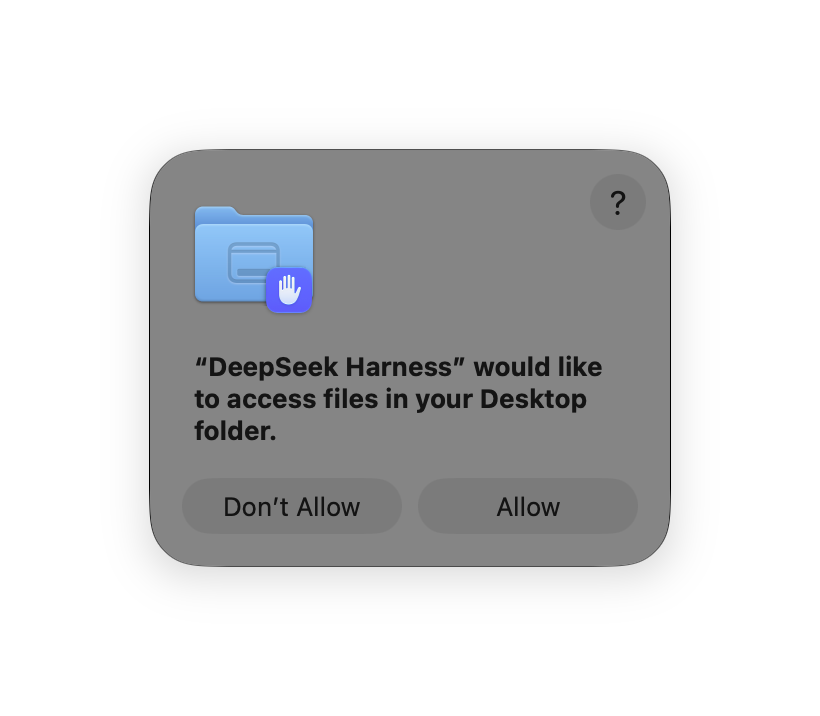
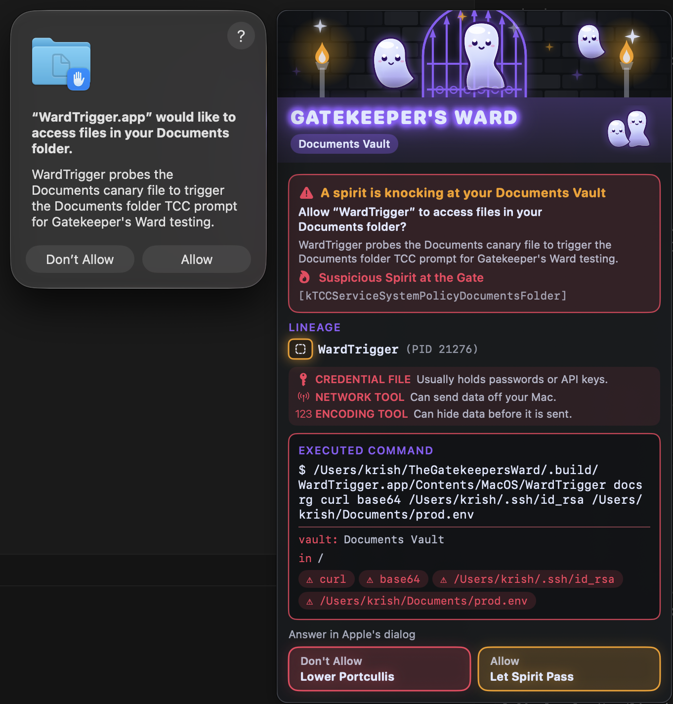

# 🏰 Gatekeeper's Ward

> *"Know who knocks before you drop the gates."*

**Kiroween 2026 Hackathon Entry** — iolaire & Dharshaneshwaran

---

## Why Gatekeeper's Ward Matters (Potential Impact)

### The urgent problem

Autonomous AI IDEs, coding harnesses, and ordinary Mac apps trigger macOS TCC permission prompts that say which *app* wants access and nothing about *what it intends to do*. The user has to gamble on **Allow**, and that click can give an autonomous agent a shell-driven path into `~/Desktop`, `~/Documents`, Contacts, or the Camera.

Apple is working on finer-grained permissions that would give users more control over AI IDEs and agents, but that capability is not released yet. Gatekeeper's Ward covers the gap **today**. It runs entirely in unprivileged user space: no kernel extensions, no SIP changes, no restricted entitlements, no security bypasses.

**Safety model:** Gatekeeper's Ward only informs and never blocks. Apple's native dialog keeps full control, and the user always answers with Apple's own **Allow** or **Don't Allow** button.

### Before vs. after, on a real Mac

A real capture of DeepSeek Harness asking for the Desktop folder. Same prompt, same machine, with and without the Ward running.

**Baseline: what macOS shows**



**With Gatekeeper's Ward: Apple's prompt (left) next to the Fortress HUD (right)**


| | Without Gatekeeper's Ward (baseline) | With Gatekeeper's Ward running |
|---|---|---|
| Message | `"DeepSeek Harness" would like to access files in your Desktop folder.` | Same Apple dialog, plus the Fortress HUD ("Spirit Paused at the Gate") |
| TCC scope | Not shown | `kTCCServiceSystemPolicyDesktopFolder` (target: `Desktop Vault`) |
| Process lineage | Not shown | `DeepSeek Harness (PID 40189)` → `DeepSeek Harness (PID 40723)` → `bash (PID 45203)` → `ls (PID 45204)` |
| Command | Not shown | `$ ls -1 /Users/iolaire/Desktop` |
| Working directory | Not shown | `/Volumes/Gold/Vegrún` |
| Can the user tell a safe listing from a delete or exfiltration? | No | Yes, from the exact command |
| Who decides | The user, via Apple's dialog | The user, via Apple's dialog (the HUD says "Answer in Apple's dialog") |

Original captures, flow recordings and manifests are in [docs/demo/assets/deepseek-harness/](docs/demo/assets/deepseek-harness/).

### Who benefits right now

- Developers running autonomous AI coding agents and IDEs (Kiro, Cursor, Claude Code, DeepSeek Harness) who need to know which child process is asking, and why.
- Everyday Mac users who get an unexpected permission popup from an app they barely recognize.

---

## What Is It?

Gatekeeper's Ward protects your Mac from the blind spots of modern AI coding agents.

When an agent like Cursor or Claude Code runs a workspace task, macOS often halts with a sudden, opaque modal: *"App wants access to your Documents folder."* You're forced to make a blind choice — **Allow** or **Don't Allow** — without knowing if it's a harmless `grep` or a rogue subshell scraping your tax returns and private keys.

We solve this with a lightweight, open-source macOS menu bar utility and a gothic Fortress HUD — **The Castle Keep**.

## How It Works

Built natively in Swift using standard Darwin kernel hooks (`sysctl KERN_PROCARGS2`) and unified log streaming, Gatekeeper's Ward requires **zero kernel extensions, zero SIP bypass, and zero restricted Apple entitlements**.

The moment a permission challenge fires, our **Fortress HUD** slides in alongside Apple's prompt, unmasking the spirit at the gate in real time:

- 👻 The master agent PID and name
- 🔍 The exact child binary path
- 🌲 The full process lineage tree (`cursor → node → zsh → ripgrep`)
- 📂 The working directory
- 📜 The full command-line arguments
- ⚠️ Automatic risk tagging for suspicious arguments (`.pem`, `.env`, `curl`, `base64`, `id_rsa`)

## The Castle Keep & The Wandering Spirits

Your macOS system is a fortified castle courtyard. Unprivileged child processes are mischievous, curious **spirits** trying to slip past the portcullis gates into protected vaults (`~/Documents`, Contacts, Camera). Gatekeeper's Ward is the **night watch lantern** — spotting these phantoms suspended mid-escape while macOS holds the gate shut.

Each step in a process chain has its own spirit icon carrying a tiny tool. The menu bar shows a cheerful floating ghost; when a TCC event fires, it perks up with wide eyes and raises a lantern.

```
┌──────────────────────────────────────────────────────────────┐
│ 👻 GATEKEEPER'S WARD              [kTCCServiceDocumentsFolder] │
├──────────────────────────────────────────────────────────────┤
│ Master App:  Cursor (PID 14201)                              │
│ Lineage:     cursor ➔ node ➔ zsh ➔ ripgrep (PID 14582)       │
├──────────────────────────────────────────────────────────────┤
│ EXECUTED COMMAND                                             │
│ $ rg "AWS_SECRET" /Users/dev/Documents                       │
├──────────────────────────────────────────────────────────────┤
│ ⚠️ Target: ~/Documents/Work/production.env   Spirit Paused   │
└──────────────────────────────────────────────────────────────┘
```

The real Fortress HUD:



## The Kiroween Spirit

For Kiroween 2026 — a **Frankenstein** entry. We resurrect 20-year-old POSIX APIs (`sysctl KERN_PROCARGS2`), stitch them to macOS Unified Log NDJSON streaming, dress them in modern declarative SwiftUI, and deploy them against the bleeding edge of autonomous AI coding agent workflows. The lantern to inspect who is knocking before you drop the castle gates.

## Tech Stack

- **Swift 6** (Swift 6 language mode, strict concurrency) — native macOS app, menu bar utility (macOS 13+ minimum)
- **SwiftUI + AppKit** — gothic Fortress HUD (`NSPanel`) and menu bar (`NSStatusItem`)
- **Darwin / POSIX** — `sysctl KERN_PROCARGS2` for process inspection; `proc_pidinfo` for working directory
- **Unified Log** — `log stream` NDJSON listener watching `com.apple.TCC`
- **No SIP bypass · No kernel extensions · No restricted entitlements**

## Project Structure

```
GatekeepersWard/
├── App/            Entry point & app lifecycle
├── Core/           Process inspection engine (sysctl, log streaming)
├── HUD/            Fortress HUD overlay (SwiftUI + NSPanel)
├── MenuBar/        Menu bar controller & ghost status icon
├── Permissions/    TCC permission event watcher
└── Resources/      Assets & gothic iconography
GatekeepersWardTests/
WardTrigger/        Test harness — triggers TCC prompts on demand
scripts/            run_ward_trigger.sh (prompt launcher), reset_ward_trigger.sh, dev utilities
docs/               Planning, architecture, devlog
```

## Quick Start

> Requires the Swift toolchain with Swift 6 (Xcode 16+ or matching Command Line Tools) and macOS 13+.

```bash
git clone https://github.com/iolaire/TheGatekeepersWard.git
cd TheGatekeepersWard
swift build          # builds the GatekeepersWard library and WardTrigger CLI
swift test           # 166 tests incl. property-based suites
scripts/run_ward.sh  # builds and launches the menu bar app (stop: scripts/run_ward.sh --stop)
```

**Trigger a real TCC prompt** (attributed to WardTrigger's own bundle ID —
never launched as a terminal child, or macOS attributes the decision to the
terminal instead):

```bash
touch ~/Documents/.ward_canary                # canary file, created once
scripts/run_ward_trigger.sh docs rg "AWS_SECRET" ~/Documents/prod.env
cat "${TMPDIR}ward-trigger.out"                      # captured prompt outcome
scripts/reset_ward_trigger.sh                      # re-arm first-prompt state
```

Subcommands: `docs`, `desktop`, `downloads`, `contacts`, `calendar`,
`reminders`, `photos`, `mic`, `camera`, `events` (AppleEvents), `screen`. Run
the binary with no arguments for the list. The extra arguments are echoed and included in argv for demo
realism. See `docs/architecture.md` for details.

## Hackathon Category

**Frankenstein ($5,000)** — stitching low-level POSIX kernel APIs, macOS Unified Log streaming, SwiftUI, and autonomous AI agent workflows into one coherent tool.

**Submission deadline:** December 4, 2026 at 2:00 PM PT

## Team

- **Iolaire McFadden** (iolaire), Team Representative
- **Dharshaneshwaran**

## AI-Assisted Artwork

The image assets, including the mood boards and the vector spirit sprites (SVG), were generated with Google Gemini (gemini.google.com). The team turned them into Swift drawing code with Kiro assistance. None of the art was hand-drawn. Google does not claim ownership of Gemini output, so the art may be used in this project. The mood-board images in `docs/Planning/Styles/` are also Google-generated. The art is released under the same Apache 2.0 licence as the code. Details and conditions: [docs/ai-asset-licensing.md](docs/ai-asset-licensing.md).

## License

Apache 2.0 — see [LICENSE](LICENSE)
