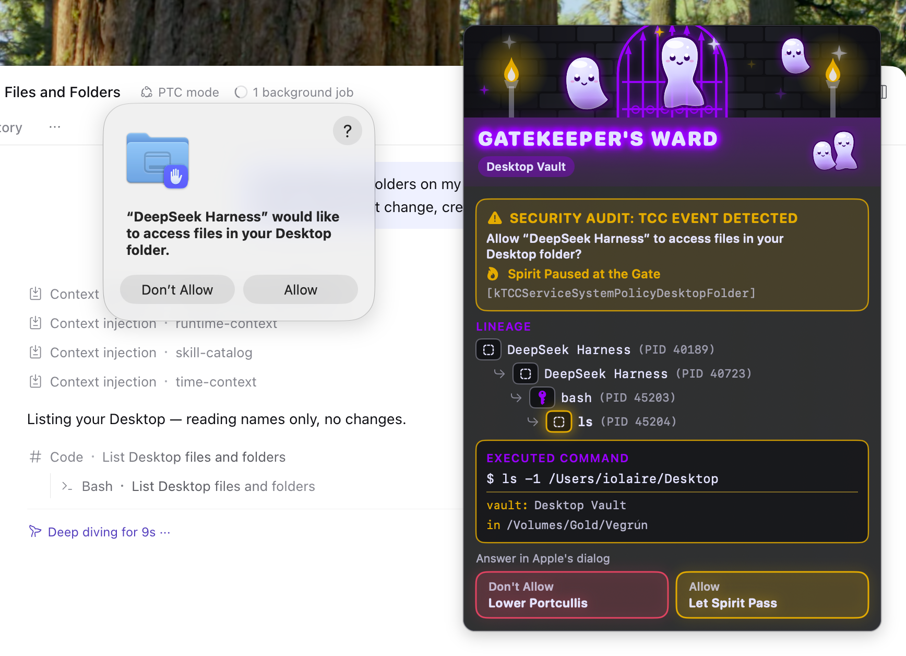
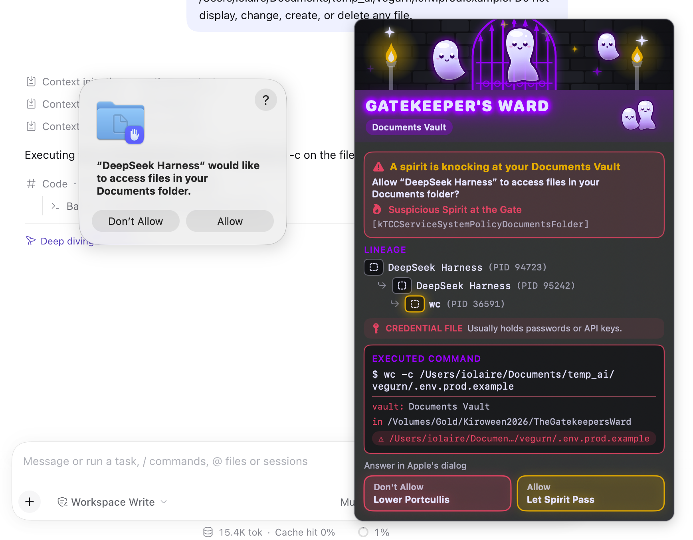
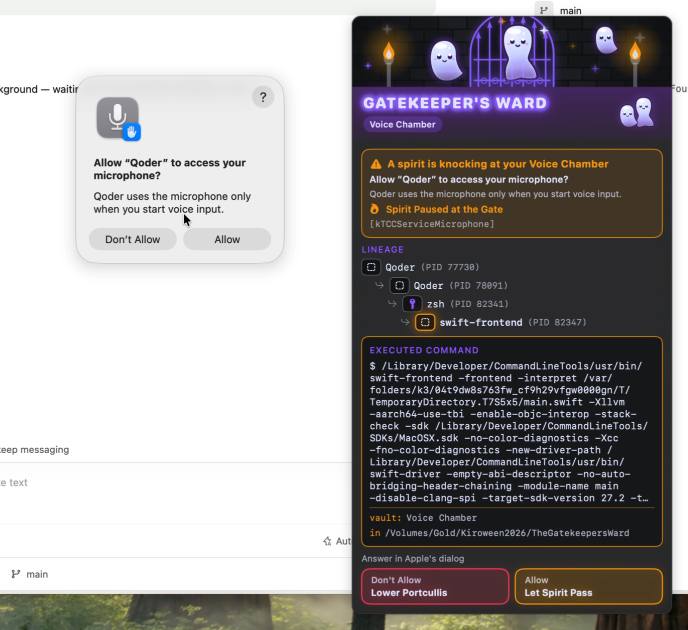

# 🏰 Gatekeeper's Ward

> *"Know who knocks before you drop the gates."*

**Kiroween 2026 Hackathon Entry** — iolaire & Dharshaneshwaran

---

## The Elevator Pitch

**Gatekeeper's Ward shows you what an app is about to do, at the moment your Mac asks "Allow?"**

When an app on your Mac wants to see your files, camera or microphone, your Mac shows a pop-up. The pop-up says **which app** is asking. It never says **what the app is about to do**.

That used to be fine. Now AI helpers run commands on your Mac for you, so a single blind click on **Allow** can hand over your documents, photos or camera.

**Gatekeeper's Ward adds a small panel right next to that pop-up.** The panel shows:

- what the app wants (for example, your Desktop folder),
- who started the request, step by step,
- the exact command being run, and where,
- red warning signs for risky things, such as password files.

The Ward only tells you. It never blocks anything and never clicks for you. You still choose **Allow** or **Don't Allow** yourself, now with the facts in front of you.

*Technical names for the curious: the pop-ups come from macOS's TCC (privacy permissions) system, and the panel is called the Fortress HUD.*

---

## Why Gatekeeper's Ward Matters (Potential Impact)

### The need, the impact and the innovation

| | |
|---|---|
| **The need** | Your Mac asks "Allow this app?" but never says what the app is about to do. AI helpers now act for you, so that blind click matters far more than it used to. |
| **The impact** | Before you click, you see what is being asked, who started it, and the exact command. A harmless file listing looks different from a copy of your password file, so you decide with facts. It works today, and because it only informs, it cannot break your workflow. |
| **The innovation** | Commands live in a text world. Permission pop-ups live in the visual world. Nothing connected the two, so the command was lost. When a pop-up opens, your Mac pauses the app that asked. We read that paused app's command and show it beside the pop-up, using only what an ordinary app is allowed to do. No special Apple access, no system changes. |

### The need, in more detail

Autonomous AI IDEs, coding harnesses, and ordinary Mac apps trigger macOS TCC permission prompts that say which *app* wants access and nothing about *what it intends to do*. The user has to gamble on **Allow**, and that click can give an autonomous agent a shell-driven path into `~/Desktop`, `~/Documents`, Contacts, or the Camera.

Apple is tightening these permissions because of AI agents, and its new options will put more prompts in front of users. Those prompts still name the app, not the command. Gatekeeper's Ward gives each one the missing context. It runs entirely in unprivileged user space: no kernel extensions, no SIP changes, no restricted entitlements, no security bypasses.

### Why now: the problem is public, and Apple is responding

- **Apple is tightening controls because of AI agents.** On Nov 16, 2026, Apple previewed new controls in **macOS 27.3 beta 2**: Device Control and Data Access splits into two settings, Full Disk Access can be limited to chosen folders, and apps can be set to "ask every time". Apple's statement: *"Before granting an app such extraordinary access, users should understand that it puts all of the data on their Mac at risk."* ([The Hacker News, Nov 17](https://thehackernews.com/2026/11/apple-tightens-macos-app-permissions-to.html); [TechCrunch, Nov 16](https://techcrunch.com/2026/11/16/apple-reveals-new-mac-security-controls-as-ai-agents-raise-privacy-risks/))
- **It is still beta.** The changes are not in a general release, so users running agents today still face the opaque prompt.
- **Developers name the gap.** In a Hacker News thread on Full Disk Access ([Oct 3, 2026](https://news.ycombinator.com/item?id=49937631)), one commenter writes: *"Granting terminal full disk access grants arbitrary scripts full disk access."* Another: *"Once I grant iTerm access to Documents for whatever reason, it always has such permission. It would be nice to limit that to a single use, or a single harness session."*
- **The prompt names the app, by design.** Commenters in the same thread explain that TCC attributes a child's file access to the app the user launched, so an `ls` run from a terminal appears as the terminal. A prompt for an agent harness therefore cannot say which command it is answering for.
- **The concern reaches beyond developers.** Enterprise analysts warn that agents with broad disk access can reach stored credentials, API keys and session tokens ([Petronella Technology Group, Oct 5](https://petronellatech.com/blog/apple-plans-tighter-macos-full-disk-access-controls-over-ai-agent-data-access/)), and a widely shared `r/mac` thread ([July 14](https://www.reddit.com/r/mac/comments/1uvxp9r/warning_new_chatgpt_mac_desktop_update_bypasses/)) reports a desktop AI app listing local files, including dotfiles such as `.env`.

**Complementary to Apple's changes.** Apple's controls decide *how much* access an app can hold: split permissions, folder limits, ask every time. Based on the published descriptions, they do not state *which command* is behind a given prompt. Gatekeeper's Ward shows that: the process lineage, the executed command (`argv`), the working directory and risky-argument tags. "Ask every time" will likely mean more prompts, and without the command behind each one that becomes prompt fatigue and blind clicks. With the Ward, each prompt is an informed decision.

**Safety model:** Gatekeeper's Ward only informs and never blocks, which is why it can be adopted today: it cannot break a workflow or weaken a macOS security boundary. Apple's native dialog keeps full control, and the user always answers with Apple's own **Allow** or **Don't Allow** button.

### Before vs. after, on a real Mac

A real capture of DeepSeek Harness asking for the Desktop folder. Same prompt, same machine, with and without the Ward running.

**Baseline: what macOS shows**


**With Gatekeeper's Ward: Apple's prompt (left) next to the Fortress HUD (right)**



| | Without Gatekeeper's Ward (baseline) | With Gatekeeper's Ward running |
|---|---|---|
| Message | `"DeepSeek Harness" would like to access files in your Desktop folder.` | Same Apple dialog, plus the Fortress HUD ("Spirit Paused at the Gate") |
| TCC scope | Not shown | `kTCCServiceSystemPolicyDesktopFolder` (target: `Desktop Vault`) |
| Process lineage | Not shown | `DeepSeek Harness (PID 40189)` → `DeepSeek Harness (PID 40723)` → `bash (PID 45203)` → `ls (PID 45204)` |
| Command | Not shown | `$ ls -1 /Users/iolaire/Desktop` |
| Working directory | Not shown | `/Volumes/Gold/Vegrún` |
| Can the user tell a safe listing from a delete or exfiltration? | No | Yes, from the exact command |
| Who decides | The user, via Apple's dialog | The user, via Apple's dialog (the HUD says "Answer in Apple's dialog") |

Original captures, flow recordings and manifests are in [docs/demo/assets/deepseek-harness/](docs/demo/assets/deepseek-harness/).

**A risky command: the same prompt, a different command**

The prompt on the left is identical to the benign `ls` case above, but this time the agent ran `wc -c /Users/iolaire/Documents/temp_ai/vegurn/.env.prod.example` against the Documents folder. The HUD flags the path as a **CREDENTIAL FILE** ("Usually holds passwords or API keys"), marks the spirit "Suspicious Spirit at the Gate", and highlights the path in the command in Mischief Crimson. The command prints only a byte count, and the file is a `.example` template, so no secrets were involved.



Apple's dialog alone reads the same for this command and for a harmless one. The HUD is what separates them.

**A second AI IDE and permission: Qoder asking for the Microphone**



The Executed Command is less readable here. The agent ran a `swift -e` one-liner, so the HUD shows the compiler process (`swift-frontend -interpret …`) rather than the original command. The lineage still makes the source clear: `Qoder (PID 44386)` → `Qoder (PID 44767)` → `zsh (PID 63090)` → `swift-frontend (PID 63093)`, started from `/Volumes/Gold/Kiroween2026/TheGatekeepersWard`. Captures are in [docs/demo/assets/qoder/](docs/demo/assets/qoder/).

### Demo video

A scripted draft (about 2:47) built from the real captures above lives in [docs/demo/remotion/](docs/demo/remotion/). The timed narration is in [VOICEOVER.md](docs/demo/remotion/VOICEOVER.md), and the folder README explains how to render it and swap in a final recording.

*Third-party product names (DeepSeek Harness, Qoder) and Apple's macOS prompts appear in these captures only to show Gatekeeper's Ward working with them. No affiliation or endorsement is claimed. See [docs/ai-asset-licensing.md](docs/ai-asset-licensing.md#third-party-names-and-captures).*

### Who benefits right now

- Developers running autonomous AI coding agents and IDEs (Kiro, Cursor, Claude Code, DeepSeek Harness) who need to know which child process is asking, and why.
- Everyday Mac users who get an unexpected permission popup from an app they barely recognize.

---

### How it compares to existing tools

Gatekeeper's Ward does one narrow job: when a TCC prompt is on screen, it shows the command behind it. The tools below solve neighboring problems, and several can block things that the Ward only reports.

| | Apple's TCC prompt | Little Snitch | Santa | Objective-See (LuLu, OverSight) | `log stream` by hand | **Gatekeeper's Ward** |
|---|---|---|---|---|---|---|
| Main job | Ask the user to allow a protected resource | Network connection firewall | Allow or block binary execution | Firewall, camera and mic use alerts, persistence checks | Read raw system logs | Explain who is behind a TCC prompt |
| Reacts to a TCC prompt | Is the prompt | No | No | No (OverSight reports camera and mic use, not the prompt) | Yes, if you know the predicate | **Yes** |
| Shows the child command, args and cwd | No (app name only) | No | Shows the binary, not the prompt context | No | No, needs `ps` and `lsof` follow-up | **Yes** |
| Shows the process lineage | No | No | No | No | No | **Yes** |
| Flags risky arguments (`.pem`, `.env`, `curl`) | No | No | No | No | No | **Yes** |
| Can block | Yes, the user decides | Yes | Yes | Yes (LuLu) | No | No, it informs only |
| Needs a kernel or system extension, or restricted entitlement | No | Yes (network extension) | Yes (Endpoint Security) | Yes for most | No | **No** |

*Summary based on each project's public documentation. Verify a row before quoting it elsewhere.*

---

## What Is It?

Gatekeeper's Ward protects your Mac from the blind spots of modern AI coding agents.

When an agent like Cursor or Claude Code runs a workspace task, macOS often halts with a sudden, opaque modal: *"App wants access to your Documents folder."* You're forced to make a blind choice — **Allow** or **Don't Allow** — without knowing if it's a harmless `grep` or a rogue subshell scraping your tax returns and private keys.

We solve this with a lightweight, open-source macOS menu bar utility and a gothic Fortress HUD — **The Castle Keep**.

## How It Works

Built natively in Swift using standard Darwin kernel hooks (`sysctl KERN_PROCARGS2`) and unified log streaming, Gatekeeper's Ward requires **zero kernel extensions, zero SIP bypass, and zero restricted Apple entitlements**.

The moment a permission challenge fires, our **Fortress HUD** slides in alongside Apple's prompt, unmasking the spirit at the gate in real time:

- 👻 The master agent PID and name
- 🔍 The exact child binary path
- 🌲 The full process lineage tree (`cursor → node → zsh → ripgrep`)
- 📂 The working directory
- 📜 The full command-line arguments
- ⚠️ Automatic risk tagging for suspicious arguments (`.pem`, `.env`, `curl`, `base64`, `id_rsa`)

### For the technically curious: why this works in user space

Tools that need to see short-lived CLI commands (`ls`, `cat`, `rg`) usually reach for Apple's Endpoint Security framework. That needs a restricted entitlement and a system extension. And by the time an ordinary app reads a log line, a fast child process has often exited, so there is nothing left to inspect.

The Ward uses a different window. While a permission dialog is open, `tccd` does not answer the process that asked, so that process (and its parents) stays in the Darwin process table. That gives an unprivileged app time to read it:

1. **Trigger.** A background `/usr/bin/log stream` listener filtered to `com.apple.TCC` catches the prompt event and extracts the TCC service key, the client PID and the responsible PID.
2. **Process facts.** `sysctl(KERN_PROCARGS2)` returns the raw `argv`. `sysctl(KERN_PROC_PID)` walks the ancestor chain up to the parent IDE. `proc_pidinfo(PROC_PIDVNODEPATHINFO)` gives the working directory.
3. **Risk triage.** The command and paths are checked against secret and exfiltration patterns (`.env`, `.pem`, `id_rsa`, `curl`, `base64`), and matches are highlighted in Mischief Crimson.
4. **Fortress HUD.** A floating `NSPanel` (`.nonactivatingPanel`, `.borderless`) appears beside Apple's dialog without taking key focus. The user still answers in Apple's own dialog.

If the process has already exited, the HUD shows partial information with a note.

### Agent-agnostic, at the OS boundary

IDE plugins, agent hooks and MCP gateways only see commands that a cooperative, supported agent chooses to route through them. The Ward watches the macOS privacy boundary instead. Cursor, Claude Code, Kiro, DeepSeek Harness, Qoder, a script run by an `npm postinstall`, or an unvetted MCP server: if it triggers a protected-resource prompt, the Ward shows what is behind it.

## The Castle Keep & The Wandering Spirits

Your macOS system is a fortified castle courtyard. Unprivileged child processes are mischievous, curious **spirits** trying to slip past the portcullis gates into protected vaults (`~/Documents`, Contacts, Camera). Gatekeeper's Ward is the **night watch lantern** — spotting these phantoms suspended mid-escape while macOS holds the gate shut.

Each step in a process chain has its own spirit icon carrying a tiny tool. The menu bar shows a cheerful floating ghost; when a TCC event fires, it perks up with wide eyes and raises a lantern.

```
┌──────────────────────────────────────────────────────────────┐
│ 👻 GATEKEEPER'S WARD              [kTCCServiceDocumentsFolder] │
├──────────────────────────────────────────────────────────────┤
│ Master App:  Cursor (PID 14201)                              │
│ Lineage:     cursor ➔ node ➔ zsh ➔ ripgrep (PID 14582)       │
├──────────────────────────────────────────────────────────────┤
│ EXECUTED COMMAND                                             │
│ $ rg "AWS_SECRET" /Users/dev/Documents                       │
├──────────────────────────────────────────────────────────────┤
│ ⚠️ Target: ~/Documents/Work/production.env   Spirit Paused   │
└──────────────────────────────────────────────────────────────┘
```

The real Fortress HUD:


## The Kiroween Spirit

For Kiroween 2026 — a **Frankenstein** entry. We resurrect 20-year-old POSIX APIs (`sysctl KERN_PROCARGS2`), stitch them to macOS Unified Log NDJSON streaming, dress them in modern declarative SwiftUI, and deploy them against the bleeding edge of autonomous AI coding agent workflows. The lantern to inspect who is knocking before you drop the castle gates.

## Tech Stack

- **Swift 6** (Swift 6 language mode, strict concurrency) — native macOS app, menu bar utility (macOS 13+ minimum)
- **SwiftUI + AppKit** — gothic Fortress HUD (`NSPanel`) and menu bar (`NSStatusItem`)
- **Darwin / POSIX** — `sysctl KERN_PROCARGS2` for process inspection; `proc_pidinfo` for working directory
- **Unified Log** — `log stream` NDJSON listener watching `com.apple.TCC`
- **No SIP bypass · No kernel extensions · No restricted entitlements**

## Project Structure

```
GatekeepersWard/
├── App/            Entry point & app lifecycle
├── Core/           Process inspection engine (sysctl, log streaming)
├── HUD/            Fortress HUD overlay (SwiftUI + NSPanel)
├── MenuBar/        Menu bar controller & ghost status icon
├── Permissions/    TCC permission event watcher
└── Resources/      Assets & gothic iconography
GatekeepersWardTests/
WardTrigger/        Test harness — triggers TCC prompts on demand
scripts/            run_ward_trigger.sh (prompt launcher), reset_ward_trigger.sh, dev utilities
docs/               Planning, architecture, devlog
```

## Quick Start

> Requires the Swift toolchain with Swift 6 (Xcode 16+ or matching Command Line Tools) and macOS 13+.

```bash
git clone https://github.com/iolaire/TheGatekeepersWard.git
cd TheGatekeepersWard
swift build          # builds the GatekeepersWard library and WardTrigger CLI
swift test           # 169 tests incl. property-based suites
scripts/run_ward.sh  # builds and launches the menu bar app (stop: scripts/run_ward.sh --stop)
```

**Trigger a real TCC prompt** (attributed to WardTrigger's own bundle ID —
never launched as a terminal child, or macOS attributes the decision to the
terminal instead):

```bash
touch ~/Documents/.ward_canary                # canary file, created once
scripts/run_ward_trigger.sh docs rg "AWS_SECRET" ~/Documents/prod.env
cat "${TMPDIR}ward-trigger.out"                      # captured prompt outcome
scripts/reset_ward_trigger.sh                      # re-arm first-prompt state
```

Subcommands: `docs`, `desktop`, `downloads`, `contacts`, `calendar`,
`reminders`, `photos`, `mic`, `camera`, `events` (AppleEvents), `screen`. Run
the binary with no arguments for the list. The extra arguments are echoed and included in argv for demo
realism. See `docs/architecture.md` for details.

### Optional: the Darwin docs MCP server

`.kiro/settings/mcp.json` registers `darwin-tcc-docs`, a local Python MCP server we used with Kiro to look up Darwin headers, TCC service keys and the `KERN_PROCARGS2` layout. It is not needed to build or run the app. The virtual environment it uses is git-ignored, so create it once (Python 3.12 or newer; the setup below was checked on a fresh venv):

```bash
python3 -m venv .kiro/tools/.venv
.kiro/tools/.venv/bin/python -m pip install -r .kiro/tools/requirements.txt
.kiro/tools/.venv/bin/python -m pytest .kiro/tools/tests/ -q   # optional check: 55 pass, 1 skipped
```

Then open the repository in Kiro. It starts the server from `.kiro/settings/mcp.json` (`.kiro/tools/.venv/bin/python .kiro/tools/mcp_darwin_server.py`, relative to the repo root). More detail, including a `uv` variant, is in [.kiro/tools/README.md](.kiro/tools/README.md).

## Hackathon Category

**Frankenstein ($5,000)** — stitching low-level POSIX kernel APIs, macOS Unified Log streaming, SwiftUI, and autonomous AI agent workflows into one coherent tool.

**Submission deadline:** December 4, 2026 at 2:00 PM PT

## Team

Two builders in two time zones, working with Kiro.

<table>
<tr>
<td align="center" width="50%" valign="top">
<br />
<b>Dharshaneshwaran D</b><br />
Bengaluru, Karnataka, India<br />
<a href="https://www.linkedin.com/in/dharshaneshwaran/">LinkedIn</a>
</td>
<td align="center" width="50%" valign="top">
<br />
<b>Iolaire McFadden</b> (Team Representative)<br />
Arlington, Virginia, United States<br />
<a href="https://www.linkedin.com/in/iolaire-mcfadden-240484/">LinkedIn</a>
</td>
</tr>
</table>

**Dharshaneshwaran D** is an AI, IoT and creative technology developer who builds smart, interactive systems with machine learning, automation and embedded hardware, and a 2D and 3D artist (Photoshop, Premiere Pro, After Effects, Blender, Unreal Engine). Past projects include Venom AI Assistant (a multilingual voice and text assistant), EcoCell (an ESP32 prototype for EV battery recycling education), and a face-recognition attendance system. The goal: bridge creativity and technology, with intelligent, aesthetic, impactful experiences.

**Iolaire McFadden** spent 25 years in the commercial real estate data industry, as Director of Data Science and Quantitative Quality Assurance Director, building time series methods, datasets and rating systems. Since early retirement in 2024, Iolaire spends several hours a day building web apps with AI-assisted coding tools, such as Vedfolnir (a tool for creating accessible content for the non-commercial Fediverse), and volunteers with local charities and theaters.

### How we built this together

We pair with Kiro on specs first, then code, and keep a public record of it in [docs/devlog.md](docs/devlog.md).

The full answer to how we used Kiro (IDE, CLI and Crew, hooks, specs versus vibe coding, steering, MCP, property-based testing, powers) is in [docs/KIRO_USAGE.md](docs/KIRO_USAGE.md).

- **Dharshaneshwaran** built the first working app on the `dev` branch: the menu bar app, the TCC watcher, the process inspector and the Fortress HUD, including the fix for the macOS 27 log format. Later work: re-running the hackathon review, and the plain-language HUD banner and risk reasons.
- **Iolaire** set up the project, specs and steering files, built the WardTrigger test harness, the permission capture framework and the real-device before/after captures, and produced the demo video and impact docs.
- **Together** we review each other's branches, merge them with `--no-ff` so each person's commits stay in the history, and use Kiro specs, hooks and property-based tests as the shared source of truth.

## AI-Assisted Artwork

The image assets, including the mood boards and the vector spirit sprites (SVG), were generated with Google Gemini (gemini.google.com). The team turned them into Swift drawing code with Kiro assistance. None of the art was hand-drawn. Google does not claim ownership of Gemini output, so the art may be used in this project. The mood-board images in `docs/Planning/Styles/` are also Google-generated. The art is released under the same Apache 2.0 licence as the code. Details and conditions: [docs/ai-asset-licensing.md](docs/ai-asset-licensing.md).

## License

Apache 2.0 — see [LICENSE](LICENSE)
