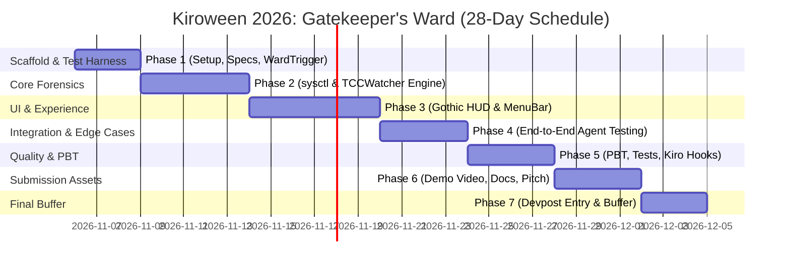

### 🏰 Review & Strategic Thoughts: Gatekeeper’s Ward for Kiroween 2026

The concept is **exceptionally strong**. In the current explosion of autonomous AI coding agents (Kiro, Claude Code, Cursor, Copilot Workspace), the "opaque modal" problem is a universal developer frustration. Addressing macOS TCC opacity using purely unprivileged userspace APIs is both practically useful and thematically brilliant for Kiroween.

Here is an analysis of your project against the official hackathon rules, technical feasibility, and strategic advice to maximize your score across the judging criteria.

---

### 1. Hackathon Category & Positioning

* **Target Category: Frankenstein ($5,000) or Resurrection ($5,000)**
  * **Frankenstein angle:** Stitching together low-level 20-year-old POSIX kernel APIs (`sysctl KERN_PROCARGS2`), macOS Unified Log NDJSON streaming, modern declarative SwiftUI, and cutting-edge autonomous AI coding agent workflows. This fits the *"stitch together a chimera of technologies into one app"* prompt to the letter.
  * **Bonus consideration (Costume Contest):** Your gothic aesthetic (dark stone palette, fortress HUD overlay, skull status icon) means you can also contend strongly here if the UI is polished.
* **Eligible Bonus Prizes to Target:**
  * **Best Demo ($1,000):** Must be $\le 3$ minutes on a real device. Showing an AI agent running a terminal command and having the Fortress HUD instantly reveal the hidden script before clicking "Allow" makes for an unforgettable demo video.
  * **Best Kiro Crew App ($1,000):** If you use Kiro Crew or build an agent companion workflow.
  * **Bonus Blog & Social Blitz Prizes:** High-probability bonus points/credits for simple write-ups on Dev.to / Medium / X using `#KiroweenHackathon26`.

---

### 2. Critical Compliance & Hackathon Rule Checks

Reviewing your workspace against `docs/Planning/HackathonDetails/Rules.md` reveals a few immediate items to address:

1. **Missing `LICENSE` File:**
   * Rule requirement: *“must be public and open source by including an open source license file. This license should be detectable and visible at the top of the repository page.”*
   * Your [README.md](file:///Volumes/Gold/Kiroween2026/TheGatekeepersWard/README.md) links to `LICENSE` (MIT at the time; now Apache 2.0), but the file does not exist yet at the repo root. We should add `LICENSE` immediately.
2. **`.kiro/` Directory Requirements:**
   * Rule requirement: *“must contain the `/.kiro` directory at the root of the project to show usage of specs, hooks, and steering. Do NOT add the `/.kiro` directory to your `.gitignore`.”*
   * Currently, you have `.kiro/steering/project.md` and an empty `.kiro/hooks/`, but **no `.kiro/specs/` directory**. Adding formal specs here will directly score points in the *Technological Implementation (20%)* bucket.
3. **Property-Based Testing (PBT):**
   * The overview specifically prompts judges to check: *“Did PBT help catch any issues you might have missed with unit tests? What kind of requirements did you enable PBT for?”*
   * The binary parser for `sysctl KERN_PROCARGS2` and the `ndjson` log regex parser are prime candidates for Property-Based Testing (e.g. generating arbitrary byte arrays and malformed log lines to ensure zero crashes).

---

### 3. Technical Feasibility & Architectural Nuances

The core approach outlined in [WhatWeAreBuildingLong.md](file:///Volumes/Gold/Kiroween2026/TheGatekeepersWard/docs/Planning/WhatWeAreBuildingLong.md) is sound, with a few implementation details to keep in mind:

1. **Process Blocking Behavior:**
   * When macOS triggers a TCC prompt for a child process (e.g. `rg` or `python` touching `~/Documents`), `tccd` puts that process thread to sleep until the user clicks Allow/Don't Allow.
   * **Why this is great for you:** The process stays in the Darwin process table! `sysctl(KERN_PROCARGS2, pid)` will succeed reliably because the process cannot exit while the dialog is active.
2. **Log Stream Parsing Across macOS Versions:**
   * Modern macOS `tccd` events format messages like:
     `requestor: TCCDProcess: identifier=..., pid=..., auid=..., binary_path=... is checking access for accessor TCCDProcess: ...`
   * We should ensure the parser supports both the structured `ndjson` fields (`processID`, `timestamp`) and regex extraction on `eventMessage`, with a fallback to `access` category filters so changes in internal wording don't break the detector.
3. **HUD Window Mechanics (`NSPanel`):**
   * The HUD window should be an `NSPanel` configured as:
     * `styleMask: [.nonactivatingPanel, .borderless]`
     * `level: .floating` or `.popUpMenu` (so it appears over normal app windows without stealing key focus from the native TCC modal)
     * Positioned near the upper-right or dynamically offset near the native prompt.
4. **Test Harness App (Item #1 in `WhatsNeeded.md`):**
   * To build and test without having to repeatedly wipe TCC permissions for your main IDE, we should create a lightweight test CLI (`scripts/trigger_tcc.sh` or a mini Swift binary) that attempts to access `~/Documents/secret.txt` or query Contacts, triggering a fresh prompt on demand via `tccutil reset`.

---

### 4. Recommended Implementation Roadmap (YAGNI & MVP)

**Capacity & Timeline Assumptions:**
* **Submission Deadline:** Friday, December 4, 2026 at 2:00 PM PT (5:00 PM EST).
* **Available Window:** 28 calendar days (November 6 – December 4, 2026).
* **Team Capacity:** 2 developers × 2 hours/day = 4 person-hours/day.
* **Total Budget:** 28 days × 4 person-hours/day = **112 person-hours**.
* **Methodology:** AI-assisted development (Kiro / agentic pairing) for rapid scaffolding, focused human engineering on Darwin sysctl forensics, UX polish, and video presentation.
* **Submission Target Date:** December 1–2, 2026 (providing a 48–72 hour safety buffer).

| Phase | Dates | Working Days | Total Hours (2p × 2h) | Focus & Deliverables |
|---|---|:---:|:---:|---|
| **Phase 1: Setup, Specs & Test Harness** | Nov 06 – Nov 08 | 3 days | **12 hrs** | • Apache 2.0 `LICENSE` (originally planned as MIT) & `.kiro/specs/mvp-spec.md` • `Package.swift` setup (macOS 13+) • `WardTrigger` test app (isolated bundle ID) & reset script |
| **Phase 2: Core Forensics Engine** | Nov 09 – Nov 13 | 5 days | **20 hrs** | • `ProcessInspector`: `sysctl(KERN_PROCARGS2)`, `KERN_PROC_PPID`, cwd • `TCCWatcher`: `/usr/bin/log stream` ndjson listener • Verify live detection with `WardTrigger` |
| **Phase 3: Gothic HUD & MenuBar** | Nov 14 – Nov 19 | 6 days | **24 hrs** | • `FortressHUDWindow` (`NSPanel` non-activating floating panel) • `FortressHUDView` (Gothic aesthetic, dark stone palette, skull crest, risk tags) • `MenuBarController` (`NSStatusItem` + recent history list) |
| **Phase 4: Agent Integration & Hardening** | Nov 20 – Nov 23 | 4 days | **16 hrs** | • Test real agent workflows (Cursor, Claude Code, Kiro CLI) • Process lifetime & suspension race condition hardening • Graceful fallback when child processes exit prematurely |
| **Phase 5: Quality, Tests & Kiro Scoring** | Nov 24 – Nov 27 | 4 days | **16 hrs** | • Property-Based Testing (PBT) for sysctl buffer & log parsers • Unit test suite in `GatekeepersWardTests` • Automated agent hooks in `.kiro/hooks/` (pre-commit test/build) |
| **Phase 6: Video Demo & Submission Pitch** | Nov 28 – Dec 01 | 4 days | **16 hrs** | • Script, record & edit $\le 3$-minute demo video on real Mac • Upload public demo video to YouTube • Devpost write-up (Kiro features story, Frankenstein theme) • Optional Bonus: Blog post & `#KiroweenHackathon26` social post |
| **Phase 7: Final Polish, Review & Buffer** | Dec 02 – Dec 04 | 2.5 days | **8 hrs** | • Complete Devpost submission form early • Verify public GitHub repository, license tag, and `.kiro/` visibility • Buffer for unexpected review or video re-encoding |
| **TOTAL** | **Nov 06 – Dec 04** | **28 days** | **112 hrs** | **Complete MVP + Demo + Compliant Devpost Submission** |

---

### Detailed Phase Breakdown

#### Phase 1: Setup, Specs & Test Harness (Nov 06 – Nov 08 | 12 Person-Hours)
* **Goal:** Establish compliance foundations and build the deterministic TCC trigger.
* **Tasks:**
  1. Add `LICENSE` (originally MIT; now Apache 2.0) with detectable GitHub tag.
  2. Create formal `.kiro/specs/mvp-spec.md` for spec-driven development points.
  3. Initialize `Package.swift` supporting macOS 13+.
  4. Build `WardTrigger` test app (dual-mode: standalone bundle `com.gatekeepersward.ward-trigger` + CLI subshell simulator).
  5. Create `scripts/reset_trigger.sh` for one-command permission resets.

#### Phase 2: Core Forensics Engine (Nov 09 – Nov 13 | 20 Person-Hours)
* **Goal:** Reliable userspace extraction of process arguments and log streaming.
* **Tasks:**
  1. Implement `ProcessInspector`:
     * Pure Darwin buffer parser for `KERN_PROCARGS2` (argc, executable path, argv).
     * Ancestor chain resolution via `sysctl(KERN_PROC_PID)` walking up to the agent PID.
     * Working directory extraction via `proc_pidinfo(PROC_PIDVNODEPATHINFO)`.
  2. Implement `TCCWatcher`:
     * Background `/usr/bin/log stream` subprocess targeting `subsystem == "com.apple.TCC"`.
     * NDJSON stream parser extracting `service`, `clientPID`, and `responsiblePID`.
  3. Integration milestone: Trigger a prompt with `WardTrigger` and print the exact resolved command to stdout.

#### Phase 3: Gothic HUD & MenuBar (Nov 14 – Nov 19 | 24 Person-Hours)
* **Goal:** Visually striking, non-interfering UI that embodies the Frankenstein/Costume Contest themes.
* **Tasks:**
  1. `FortressHUDWindow`: Frameless `NSPanel` at `.floating` level with `.nonactivatingPanel` so key focus stays on Apple's dialog.
  2. `FortressHUDView`: Gothic SwiftUI interface with obsidian background (`#0E1013`), wrought-iron borders, lineage tree view, and crimson risk tags for suspicious args (`.pem`, `curl`, `base64`).
  3. `MenuBarController`: Status item with skull icon, active watcher indicator, and dropdown list of past permission challenges.

#### Phase 4: Agent Integration & Hardening (Nov 20 – Nov 23 | 16 Person-Hours)
* **Goal:** Ensure smooth operation when interacting with real autonomous coding agents.
* **Tasks:**
  1. Run live agent tasks with Cursor / Claude Code / Kiro CLI touching protected directories.
  2. Handle process lifetime edge cases (processes that complete before sysctl query vs processes suspended by TCC).
  3. Handle multi-monitor positioning and display scaling.

#### Phase 5: Quality, Tests & Kiro Scoring (Nov 24 – Nov 27 | 16 Person-Hours)
* **Goal:** Secure high marks in *Technological Implementation (20%)* via Kiro features.
* **Tasks:**
  1. Implement Property-Based Testing (PBT) using Swift testing/SwiftCheck on randomized byte arrays for `parseProcArgsBuffer` and malformed log lines.
  2. Write unit tests for process chain walking and service key formatting.
  3. Configure `.kiro/hooks/` for automated pre-commit and pre-push test enforcement.

#### Phase 6: Video Demo & Submission Pitch (Nov 28 – Dec 01 | 16 Person-Hours)
* **Goal:** Maximize score in *Presentation (20%)* and *Potential Impact (20%)*.
* **Tasks:**
  1. Script a tight 2.5-minute demo video showing the problem and instant HUD resolution.
  2. Record screen capture on a real Mac with real AI agent commands.
  3. Edit video, add clear audio commentary, and upload publicly to YouTube.
  4. Draft Devpost text description highlighting Kiro spec-driven development, hooks, and PBT.
  5. Draft short public blog post and social post for bonus prize categories.

#### Phase 7: Final Polish, Review & Buffer (Dec 02 – Dec 04 | 8 Person-Hours)
* **Goal:** Stress-free submission ahead of the hard deadline.
* **Tasks:**
  1. Final submission on Devpost by December 2.
  2. Smoke test repository clone and build instructions on a clean environment.
  3. Stand by for any hackathon organizer communications.

---

### Next Step

Whenever you're ready, we can:
1. Generate the missing `LICENSE` and scaffold `.kiro/specs/` and `.kiro/hooks/` to lock in hackathon compliance.
2. Initialize the Swift project build structure (`Package.swift` / Xcode).
3. Build the core `ProcessInspector` and `TCCWatcher`.

Let me know which part you'd like to dive into first!