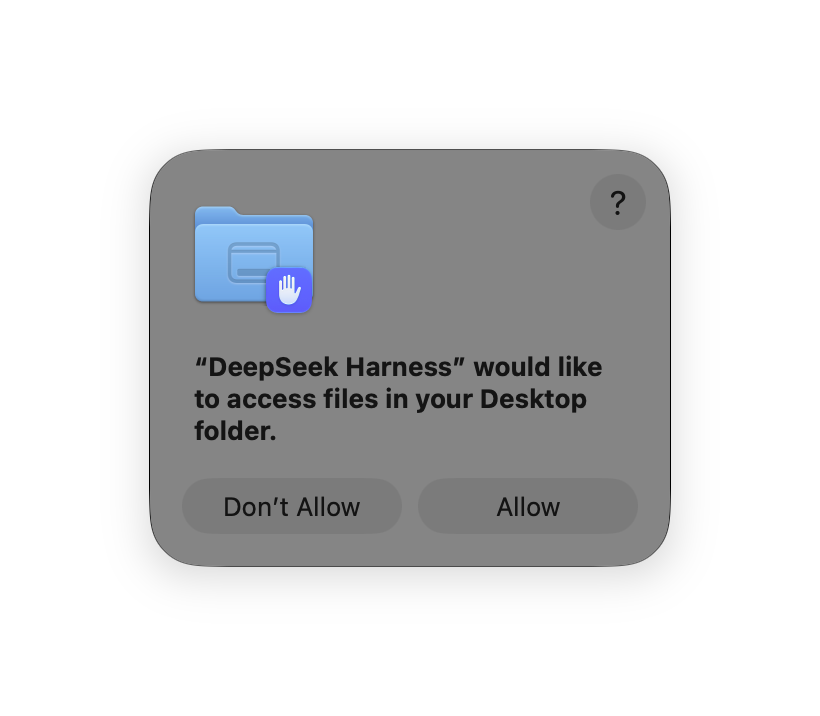
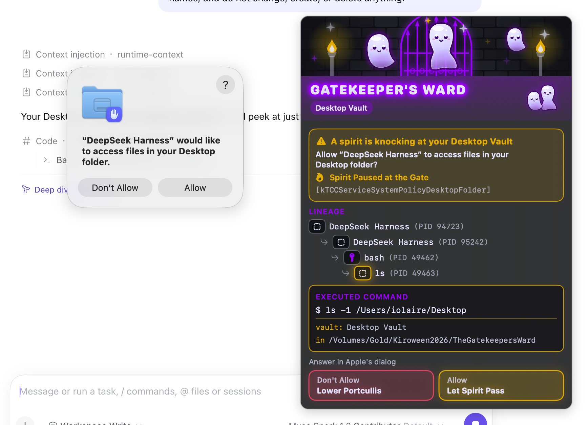
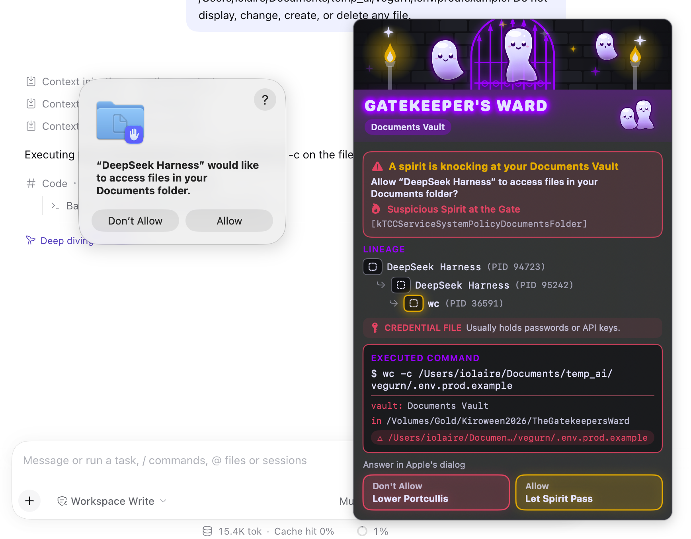

# Gatekeeper's Ward — Hackathon Pitch

**Kiroween 2026 | Team: iolaire & Dharshaneshwaran**

---

## The Problem

Modern AI coding agents (Cursor, Claude Code, Kiro, GitHub Copilot Workspace) operate autonomously inside your filesystem. When they trigger a macOS TCC (Transparency, Consent, and Control) permission dialog, you see only:

> *"XYZ app would like to access your Documents folder."*

You have no context. Is this:
- A benign `cat README.md`?
- A subshell doing `find ~/Documents -name "*.pem"`?
- A `rg "AWS_SECRET_KEY" ~/Documents/prod.env`?

You're forced to **Allow** or **Don't Allow** blind.

---

## The Solution

**Gatekeeper's Ward** — a lightweight macOS menu bar utility that intercepts permission challenges and immediately shows a gothic Fortress HUD alongside Apple's own dialog.

```
┌──────────────────────────────────────────────────────────────┐
│ 👻 GATEKEEPER'S WARD              [kTCCServiceDocumentsFolder] │
├──────────────────────────────────────────────────────────────┤
│ Master App:  Cursor (PID 14201)                              │
│ Lineage:     cursor ➔ node ➔ zsh ➔ ripgrep (PID 14582)       │
├──────────────────────────────────────────────────────────────┤
│ EXECUTED COMMAND                                             │
│ $ rg "AWS_SECRET" /Users/dev/Documents                       │
├──────────────────────────────────────────────────────────────┤
│ ⚠️ Target: ~/Documents/Work/production.env   Spirit Paused   │
│                                                              │
│  Answer in Apple's dialog: Allow / Don't Allow               │
└──────────────────────────────────────────────────────────────┘
```

You can now make an **informed** decision.

---

## Why It Matters Now (Potential Impact)

Apple is tightening macOS permissions because of AI agents, and its new options (split permissions, folder-limited Full Disk Access, "ask every time") make users answer more prompts. Those prompts still name the app, not the command behind it. Gatekeeper's Ward gives each prompt the missing context, in unprivileged user space: no kernel extensions, no SIP changes, no restricted entitlements.

**Inform-only is why teams can adopt it today.** It never blocks or modifies anything, so it cannot break a workflow or weaken a macOS security boundary. Installing it needs no system extension, no Endpoint Security entitlement and no SIP change, which is the kind of review that normally stalls a security tool. Apple's dialog keeps full control, and the user always answers with Apple's own **Allow** or **Don't Allow** button.

### The problem is public, and Apple is responding

| Signal | What it shows |
|---|---|
| Apple, macOS 27.3 beta 2 (Nov 16, 2026) | Device Control and Data Access splits in two, Full Disk Access can be limited to chosen folders, apps can be set to "ask every time". Apple: *"Before granting an app such extraordinary access, users should understand that it puts all of the data on their Mac at risk."* ([The Hacker News](https://thehackernews.com/2026/11/apple-tightens-macos-app-permissions-to.html), [TechCrunch](https://techcrunch.com/2026/11/16/apple-reveals-new-mac-security-controls-as-ai-agents-raise-privacy-risks/)) |
| Still beta | Not in a general release. Users running agents today still get the opaque prompt. |
| Developer discussion ([Hacker News, Oct 3](https://news.ycombinator.com/item?id=49937631)) | *"Granting terminal full disk access grants arbitrary scripts full disk access."* and *"It would be nice to limit that to a single use, or a single harness session."* |
| Why the prompt is vague | TCC attributes a child's access to the app the user launched, so an `ls` run from a terminal appears as the terminal. The prompt cannot name the command. |
| Enterprise and consumer concern | Broad disk access lets agents reach credentials, API keys and session tokens ([Petronella, Oct 5](https://petronellatech.com/blog/apple-plans-tighter-macos-full-disk-access-controls-over-ai-agent-data-access/)). A widely shared `r/mac` thread reports a desktop AI app listing local files including `.env` ([Jul 14](https://www.reddit.com/r/mac/comments/1uvxp9r/warning_new_chatgpt_mac_desktop_update_bypasses/)). |

**Apple's changes make the Ward more useful, not less.** They decide how much access an app can hold, and "ask every time" will likely put more prompts in front of users. Based on the published descriptions, those prompts still do not say which command is behind them. Without the Ward, more prompts mean more blind clicks (prompt fatigue). With it, each prompt shows the lineage, `argv` and working directory. Apple also says previously granted permissions stay in effect, so existing grants keep needing this visibility.

### Real-device proof: DeepSeek Harness asks for the Desktop folder

| | What macOS shows (baseline) | What Gatekeeper's Ward reveals |
|---|---|---|
| Message | `"DeepSeek Harness" would like to access files in your Desktop folder.` | Same dialog, plus the Fortress HUD ("Spirit Paused at the Gate") |
| TCC scope | Not shown | `kTCCServiceSystemPolicyDesktopFolder` (Desktop Vault) |
| Lineage | Not shown | `DeepSeek Harness (40189)` → `DeepSeek Harness (40723)` → `bash (45203)` → `ls (45204)` |
| Command | Not shown | `$ ls -1 /Users/iolaire/Desktop` |
| Working directory | Not shown | `/Volumes/Gold/Vegrún` |

With the baseline alone, a safe directory listing and a delete or exfiltration look identical. With the HUD, the exact command settles it.





### Same kind of prompt, risky command: a credential file caught by the risk tags

Apple's dialog has the same wording as in the benign case, only for the Documents folder. The agent ran `wc -c /Users/iolaire/Documents/temp_ai/vegurn/.env.prod.example`, and the HUD flags the path as a **CREDENTIAL FILE**, marks the spirit "Suspicious Spirit at the Gate", and highlights the path in Mischief Crimson. The command prints only a byte count, and the file is a `.example` template.



| | Benign (`ls` on Desktop) | Risky (`wc -c` on a `.env` file in Documents) |
|---|---|---|
| Apple's prompt | Desktop folder text | Documents folder text |
| HUD status | Spirit Paused at the Gate | Suspicious Spirit at the Gate |
| Risk tag | None | CREDENTIAL FILE, `.env.prod.example` highlighted |

The same capture works for a second AI IDE and a different permission: Qoder asking for the Microphone ([pair shot](demo/assets/qoder/ward_qoder_microphone_pair.png)). Even though the request comes from an inline `swift -e` compiler run, the Ward traces the lineage Qoder → zsh → swift-frontend, so the user knows which app triggered the prompt. (Limits of this capture are in the technical notes at the end.)

**Who benefits now:** developers running autonomous AI coding agents and IDEs (Kiro, Cursor, Claude Code, DeepSeek Harness), and any Mac user facing an unexpected permission popup from an app they barely recognize.

---
## The Castle Keep & The Wandering Spirits

Your macOS system is a **fortified castle courtyard**. Unprivileged child processes are mischievous, curious spirits trying to slip past the portcullis gates into protected vaults. Gatekeeper's Ward is the **night watch lantern** that spots these phantoms suspended mid-escape while macOS holds the gate shut.

The process lineage tree shows each spirit carrying a contextual tool (🔍 for `ripgrep`, 🗝️ for shell scripts). The menu bar ghost perks up with wide eyes and raises a lantern the instant a TCC event fires.

---

## Why It's Compelling for Kiroween

**Frankenstein angle** — stitching together technologies that have no right to work so well together:

| Layer | Technology |
|---|---|
| Zombie API | `sysctl KERN_PROCARGS2` — 20-year-old POSIX, resurrected |
| Modern declarative | SwiftUI Fortress HUD |
| System forensics | macOS Unified Log NDJSON streaming |
| Risk triage | Heuristics that flag secret-hunting and exfiltration arguments in the command |
| Target domain | Cutting-edge autonomous AI coding agents |

This fits the *"stitch together a chimera of technologies"* prompt to the letter.

**The gothic Castle Keep aesthetic** supports the Frankenstein story rather than competing with it: obsidian background, Kiro Violet portcullis bars, Torchlight Amber lantern glow, Mischief Crimson for suspicious arguments. The theme explains the function.

---

## Differentiators

### Why nobody built this before: the core technical insight

While a permission dialog is open, `tccd` does not answer the process that asked, so that process (and its parents) stays in the Darwin process table. The Ward reads `argv`, working directory and lineage from it with an unprivileged `sysctl(KERN_PROCARGS2)` call, with no race against a short-lived command. Tools that need to see brief CLI commands usually reach for Apple's Endpoint Security framework, which needs a restricted entitlement and a system extension. The prompt itself gives the Ward the window that framework would otherwise be used for. If the process has already exited, the HUD degrades to partial information with a note.

The pipeline stitches four layers together: BSD buffer parsing (`KERN_PROCARGS2`), real-time Unified Log NDJSON streaming, risk triage of arguments (`.env`, `.pem`, `id_rsa`, `curl`, `base64`) and a non-activating SwiftUI `NSPanel` overlay. Risk triage is what turns a process viewer into a decision aid.

### How it compares to existing tools

Gatekeeper's Ward does one narrow job: when a TCC prompt is on screen, it shows the command behind it. The tools below solve neighboring problems, and several can block things that the Ward only reports.

| | Apple's TCC prompt | Little Snitch | Santa | Objective-See (LuLu, OverSight) | `log stream` by hand | Agent guardrails (IDE hooks, agent permission prompts, MCP gateways) | **Gatekeeper's Ward** |
|---|---|---|---|---|---|---|---|
| Main job | Ask the user to allow a protected resource | Network connection firewall | Allow or block binary execution | Firewall, camera and mic use alerts, persistence checks | Read raw system logs | Gate or log the actions an agent routes through its own tool layer | Explain who is behind a TCC prompt |
| Reacts to a TCC prompt | Is the prompt | No | No | No (OverSight reports camera and mic use, not the prompt) | Yes, if you know the predicate | No | **Yes** |
| Shows the child command, args and cwd | No (app name only) | No | Shows the binary, not the prompt context | No | No, needs `ps` and `lsof` follow-up | Only what a cooperating agent reports | **Yes** |
| Shows the process lineage | No | No | No | No | No | No | **Yes** |
| Flags risky arguments (`.pem`, `.env`, `curl`) | No | No | No | No | No | Varies, only for tool calls it sees | **Yes** |
| Can block | Yes, the user decides | Yes | Yes | Yes (LuLu) | No | Yes, for supported agents | No, it informs only |
| Needs a kernel or system extension, or restricted entitlement | No | Yes (network extension) | Yes (Endpoint Security) | Yes for most | No | No | **No** |

*Based on each project's public documentation.*

**Agent-agnostic and OS-boundary native.** Agent guardrails only see what a cooperating, supported agent routes through them. The Ward watches the macOS boundary instead, so it covers Cursor, Claude Code, Kiro, DeepSeek Harness, a script run from a package install hook, or an unvetted MCP server, whenever the process touches a TCC-protected resource and the prompt appears.

- **No kernel extension required** — pure userspace Swift `.app` that builds from source with zero restricted entitlements
- **No SIP bypass** — zero security compromise required to install or run
- **Open source** — developers can audit and trust it
- **Zero config** — install, launch, done
- **Real-time** — HUD appears the instant the permission dialog fires, not after

---

## Hackathon Category & Prize Strategy

| Category | Rationale |
|---|---|
| **Frankenstein ($5,000)** | Our one category: POSIX + Unified Log + SwiftUI + AI agents |
| **Best Demo ($1,000)** | ≤3 min video: agent runs command → HUD reveals hidden script instantly |
| **Bonus Blog/Social** | Short Dev.to post + `#KiroweenHackathon26` tweet for bonus credits |

---

## Hackathon Compliance Checklist

- [x] Public GitHub repository with detectable Apache 2.0 `LICENSE` file
- [x] `.kiro/` directory with `specs/`, `hooks/`, and `steering/` populated
- [x] Spec-driven development documented (scores in *Technological Implementation 20%*)
- [x] Property-Based Testing (PBT) implemented on `KERN_PROCARGS2` parser and log parser
- [ ] Demo video ≤3 minutes on a real Mac device
- [ ] Devpost submission submitted before December 4, 2026 at 2:00 PM PT

---

## Demo Flow (≤3 Minutes)

| Timecode | Scene | Narrative |
|---|---|---|
| 0:00–0:35 | AI agent running + opaque TCC modal | *"Modern agents work fast but macOS blinds us. You're forced to guess."* |
| 0:35–1:15 | Same trigger — Fortress HUD slides in alongside Apple's dialog | *"Gatekeeper's Ward unmasks the intruder instantly."* |
| 1:15–2:00 | Code walkthrough: `sysctl KERN_PROCARGS2` + Unified Log. Then a 10–15 s Kiro beat: `.kiro/specs/` folders, hooks, steering, and the property-based tests on the `KERN_PROCARGS2` and log parsers passing | *"Zero dark magic. No kernel extensions. We resurrect 20-year-old POSIX APIs. Specs, hooks and property-based tests built it with Kiro."* |
| 2:00–2:35 | Menu bar ghost, history dropdown, risk tags on suspicious args | *"Full lineage tree, process history, automatic risk tagging."* |
| 2:35–3:00 | Impact: before/after pair, Apple's macOS 27.3 beta controls (still unreleased) answer how much access, the Ward answers which command, Apache 2.0 repo link | *"Apple is tightening agent permissions, and it is still in beta. Even then, the prompt will not tell you which command is asking. The Ward does. Know who knocks before you drop the castle gates."* |

---

## Technical notes and limits

- The Qoder Microphone capture runs through an inline `swift -e` compiler, so the HUD shows the compiler process (`swift-frontend`) instead of a readable command. The lineage still identifies Qoder.
- Parsing depends on TCC log wording, which changes between macOS versions. A regex fallback on `eventMessage` covers wording drift. The real-device captures come from one macOS version.
- The Ward informs only. It cannot press or block Apple's buttons.

---

## Future (post-hackathon)

- Allow/block rules engine (auto-deny patterns matching `.pem`, `curl | sh`, etc.)
- `brew install` distribution
- Integration with popular agent frameworks' audit logs
- Optional: companion app for remote monitoring
